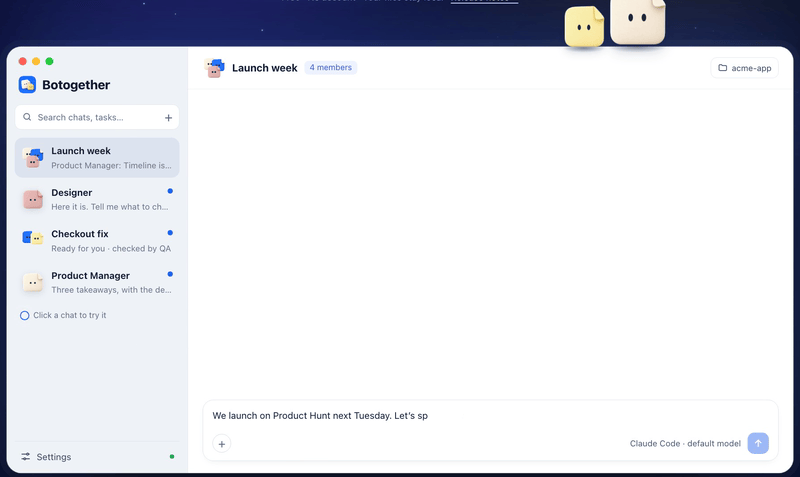
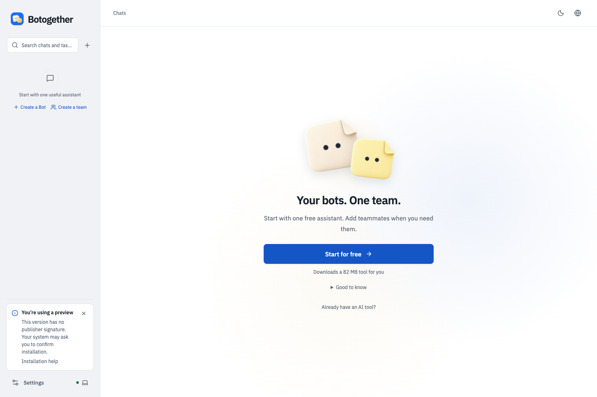
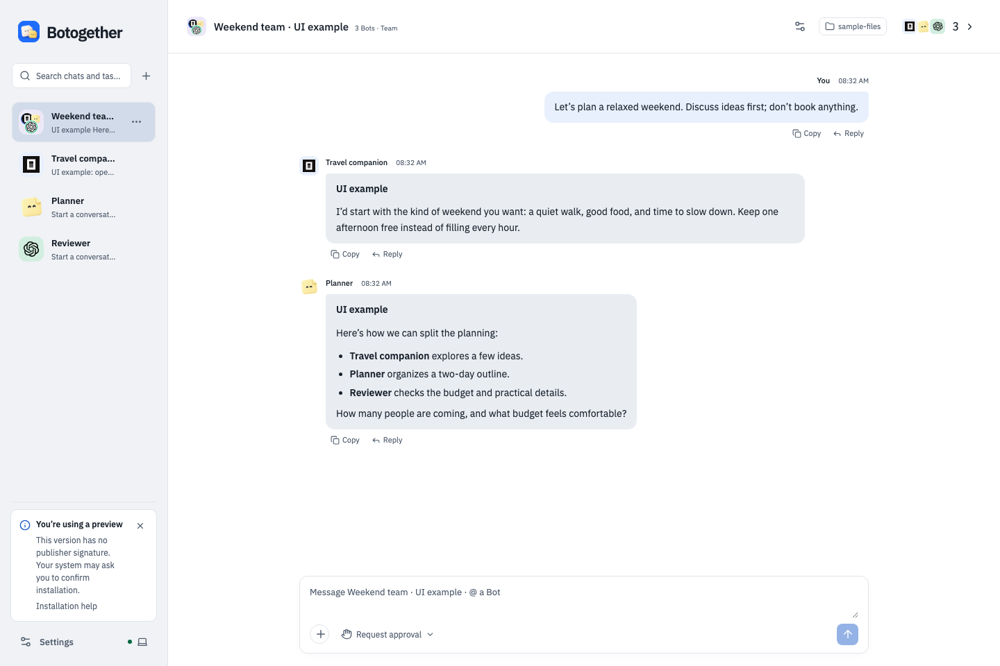
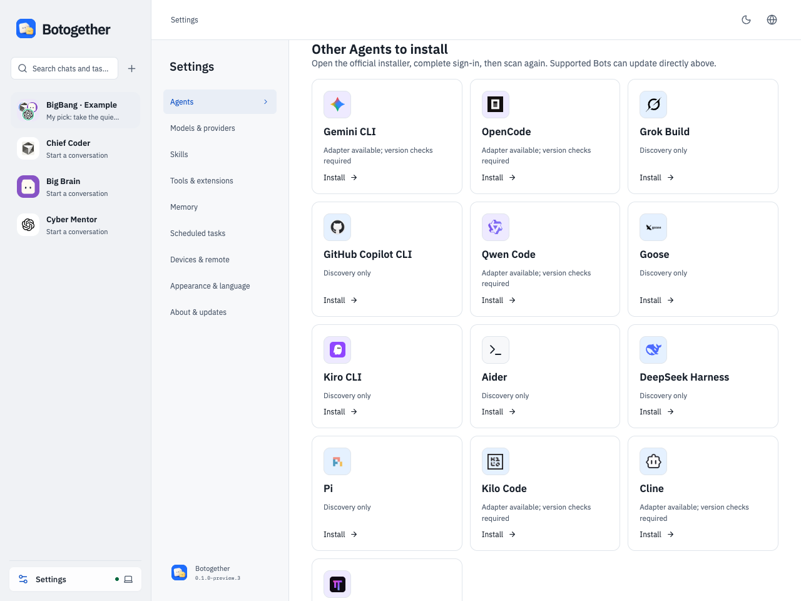
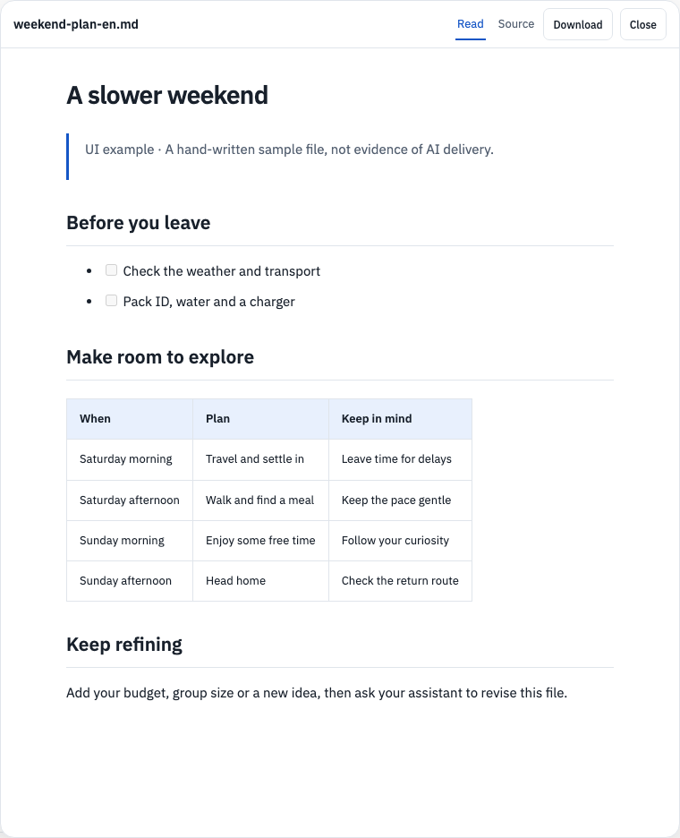

<h1 align="center">Botogether</h1>

<strong>A local-first desktop app for AI agent collaboration on Mac and Windows.</strong>

Create assistants with tools like Claude Code, Codex, and Cursor. Give them roles in one project to split up work, review changes, and deliver files you can inspect.

<a href="README.md">简体中文</a> · English

  <strong><a href="https://github.com/DmiyDing/botogether/releases/download/v0.1.0-preview.14/Botogether-0.1.0-preview.14-mac-arm64.dmg">Download for Apple silicon Mac (DMG)</a></strong> 
  <strong><a href="https://github.com/DmiyDing/botogether/releases/download/v0.1.0-preview.14/Botogether-0.1.0-preview.14-win-x64.exe">Download for Windows x64 (EXE)</a></strong>

<a href="https://github.com/DmiyDing/botogether/releases/tag/v0.1.0-preview.14">preview.14 release notes</a> · <a href="#installation-help">Installation help</a> · <a href="https://github.com/DmiyDing/botogether/releases">All releases</a>

The app is free to use. Your tool or model provider may charge separately.

## Try a task with two agents

> Add an installation guide to this project. Have one agent draft it and another check the commands and steps against the project.

For a code change, ask a second agent to look for edge cases and missing tests. Use `@` to assign work to a specific agent. For file tasks, you can open, preview, or download the delivered files.

## Start with a small task

- **Already use an AI agent?** Open **Settings → Agents** to see which tools Botogether detected. Use `+` to create an assistant. To try collaboration, create a group chat, select a project folder, and add at least two assistants.
- **New to AI agents?** Choose **Start for free** in the app, install OpenCode, and pick an available free model. Start a direct chat, ask for a file for a project you know, and open the result.

[Getting started](docs/getting-started.md) · [Troubleshooting](docs/troubleshooting.md) · [Data and privacy](docs/privacy.md)

## Screenshots

## Tools, data, and license

- **Use the tools you have.** Connect local tools such as Claude Code, Codex CLI, Cursor Agent, and OpenCode. Sign-in, model availability, and usage costs depend on the tool or provider you choose.
- **Keep your chat history and results on your computer.** Botogether stores chats, settings, and file snapshots locally. If you use a cloud model, the selected agent may send task data to its model service. [Privacy details](docs/privacy.md)
- **Public downloads and guides.** The desktop app is distributed under a [proprietary distribution license](LICENSE.md). The maintainers keep the application source private.

## Installation help

Blocked on first launch? Mac and Windows instructions

Download only from [official Releases](https://github.com/DmiyDing/botogether/releases) and verify the checksum.

**Mac:** Open the DMG, drag Botogether to Applications, and try opening it. If macOS blocks this preview, go to **System Settings → Privacy & Security** and choose **Open Anyway** when it appears. [Apple's instructions](https://support.apple.com/en-us/102445)

**Windows:** Run the EXE. If "Windows protected your PC" appears, verify the source and choose **More info → Run anyway**. If Smart App Control or an org policy blocks it, keep those protections on and report the warning. [Microsoft's guidance](https://learn.microsoft.com/en-us/windows/apps/package-and-deploy/smartscreen-reputation)

A "damaged" or malware warning means you should re-verify the download — don't dismiss it.

Checksums and ZIP alternatives

- **Mac ARM64 preview.14:** [ZIP](https://github.com/DmiyDing/botogether/releases/download/v0.1.0-preview.14/Botogether-0.1.0-preview.14-mac-arm64.zip) · [SHA256SUMS](https://github.com/DmiyDing/botogether/releases/download/v0.1.0-preview.14/Botogether-0.1.0-preview.14-mac-arm64-SHA256SUMS.txt)
- **Windows x64 preview.14:** [ZIP](https://github.com/DmiyDing/botogether/releases/download/v0.1.0-preview.14/Botogether-0.1.0-preview.14-win-x64.zip) · [SHA256SUMS](https://github.com/DmiyDing/botogether/releases/download/v0.1.0-preview.14/Botogether-0.1.0-preview.14-win-x64-SHA256SUMS.txt)
- **Intel Mac:** builds are paused; [historical preview.7](https://github.com/DmiyDing/botogether/releases/tag/v0.1.0-preview.7) is experimental and unverified on real Intel hardware.

Verify on Mac: `shasum -a 256 filename` · on Windows: `Get-FileHash -Algorithm SHA256 filename`

---

## Feedback

Found a bug? Open an [Issue](https://github.com/DmiyDing/botogether/issues) with your version, OS, and steps to reproduce. Issues are public — redact screenshots and never upload credentials or private files.

[License](LICENSE.md) · [Privacy](docs/privacy.md) · [Acknowledgments](docs/getting-started.md#acknowledgments)
