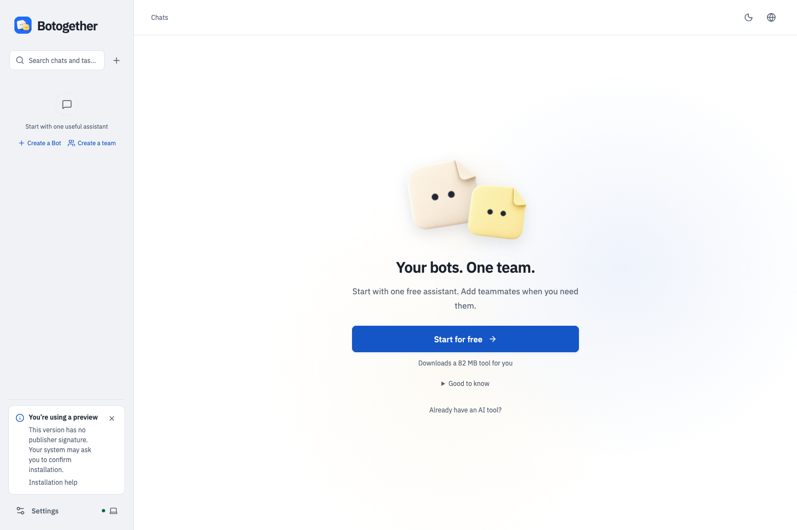
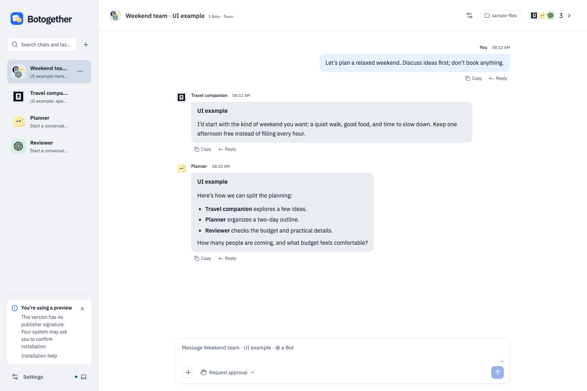
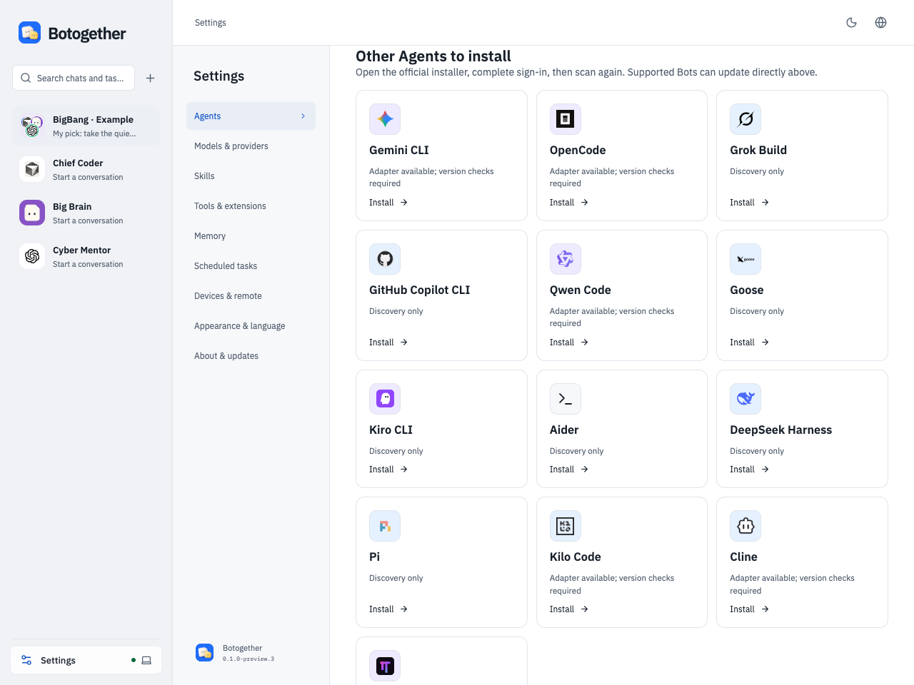

<h1 align="center">Botogether</h1>

<strong>Your bots. One team.</strong> Local AI agents, working together on your computer.

<a href="README.zh-CN.md">简体中文</a>

Chat with your coding agents, give each a role, and inspect their files and results. Botogether is free to use, with no app subscription. Your Agent or model provider may charge separately.

## Download

| Your computer | Installer | Version |
| --- | --- | --- |
| Apple Silicon Mac (M-series) | [Download DMG](https://github.com/DmiyDing/botogether/releases/download/v0.1.0-preview.10/Botogether-0.1.0-preview.10-mac-arm64.dmg) | preview.10 |
| Windows x64 | [Download EXE](https://github.com/DmiyDing/botogether/releases/download/v0.1.0-preview.10/Botogether-0.1.0-preview.10-win-x64.exe) | preview.10 |

**Testing preview:** macOS is not notarized and Windows has no publisher signature. See [installation help](#installation-help) before your first launch. [Release notes](https://github.com/DmiyDing/botogether/releases).

## Why Botogether

- **One conversation, different roles.** Ask one assistant or let a group prepare and check a result.
- **Local records.** Conversations and task files stay on your computer. Your chosen Agents and services may send prompts or files to their own cloud services.
- **Visible control.** Choose a project folder, handle permissions and inspect actual outputs. An Agent saying “done” is not a verified delivery.

## Interface preview

Isolated interface examples; capabilities depend on the Agent, model and tools you select.

## Your first task

1. **No Agent installed?** Choose **Start for free** to install OpenCode in the app.
2. Pick an available **free trial model**. Availability and limits come from the provider; the app does not silently switch to a paid model.
3. **Already have an Agent?** Create an assistant from a detected installation and sign in through the native Agent when needed.
4. Select a project folder and try “Create a weekend checklist.” Open the result and ask for a revision.
5. Add teammates when useful and choose who prepares and checks the result. More members can add usage and coordination costs.

[Getting started](docs/getting-started.md) · [Troubleshooting](docs/troubleshooting.md) · [Privacy](docs/privacy.md)

## What you can do

- Direct and group chat, with `@` to address a member.
- Shared project folders, saved duties and targeted repair after checks.
- Models and scoped instructions for each assistant.
- Visible permissions, execution records and interrupted-task recovery.
- File and image previews with original-file downloads.
- Scoped local memories, English or Simplified Chinese, and light or dark themes.

Mobile remote control, general plugin installation and complete MCP tool management are not available in this preview. Engine and model capabilities vary; check the release notes for the tested scope.

## Quick answers

**Is it free?** The app has no subscription. Agent accounts, models and third-party services have their own terms and prices.

**Where is my data?** Botogether stores its records locally. Using a cloud model can send your task content to that provider; see [Privacy](docs/privacy.md).

**Which Agents work?** The app detects supported local installations and offers installation or setup guidance. Features depend on the engine and version; see [Getting started](docs/getting-started.md).

**Is it open source?** Botogether is distributed under a [proprietary distribution license](LICENSE.md). This repository contains public guides and downloads, not the application's source.

## Installation help

First launch blocked? Mac and Windows instructions

Download only from the [official Releases](https://github.com/DmiyDing/botogether/releases) and verify the checksum below.

**Mac:** Open the DMG, drag Botogether into Applications and try opening it. If macOS blocks this preview, use **System Settings → Privacy & Security → Open Anyway** for this app when offered. [Apple's instructions](https://support.apple.com/en-us/102445).

**Windows:** Run the EXE. If “Windows protected your PC” appears, verify the source and use **More info → Run anyway** when offered. If Smart App Control or organizational policy blocks installation, keep protections enabled and report the warning. [Microsoft's guidance](https://learn.microsoft.com/en-us/windows/apps/package-and-deploy/smartscreen-reputation).

Keep Gatekeeper, SmartScreen and antivirus enabled. A damaged-app or malware warning requires checking the download and integrity; do not dismiss it blindly. Full help: [Troubleshooting](docs/troubleshooting.md).

Checksums, ZIP alternatives and other platforms

- **Mac ARM64 preview.10:** [ZIP](https://github.com/DmiyDing/botogether/releases/download/v0.1.0-preview.10/Botogether-0.1.0-preview.10-mac-arm64.zip) · [SHA256SUMS](https://github.com/DmiyDing/botogether/releases/download/v0.1.0-preview.10/Botogether-0.1.0-preview.10-mac-arm64-SHA256SUMS.txt).
- **Windows x64 preview.10:** [ZIP](https://github.com/DmiyDing/botogether/releases/download/v0.1.0-preview.10/Botogether-0.1.0-preview.10-win-x64.zip) · [SHA256SUMS](https://github.com/DmiyDing/botogether/releases/download/v0.1.0-preview.10/Botogether-0.1.0-preview.10-win-x64-SHA256SUMS.txt).
- **Intel Mac:** new builds are paused. [Historical preview.7](https://github.com/DmiyDing/botogether/releases/tag/v0.1.0-preview.7) remains experimental; native Intel GUI and upgrades were not verified.

Compare a Mac download with `shasum -a 256 filename`; on Windows use `Get-FileHash -Algorithm SHA256 filename`. A checksum proves byte consistency, not publisher identity.

Desktop installers need no Node.js or npm. Choose a DMG or EXE in Release **Assets**; automatic **Source code** archives contain only this repository's public documentation. No npm installation is offered.

## Feedback and license

[Report a problem](https://github.com/DmiyDing/botogether/issues) with your version, OS and reproduction steps. Issues are public: redact screenshots and never upload credentials, databases, chat exports or private project files.

[Distribution license](LICENSE.md) · [Privacy](docs/privacy.md) · [Project acknowledgments](docs/getting-started.md#acknowledgments)
