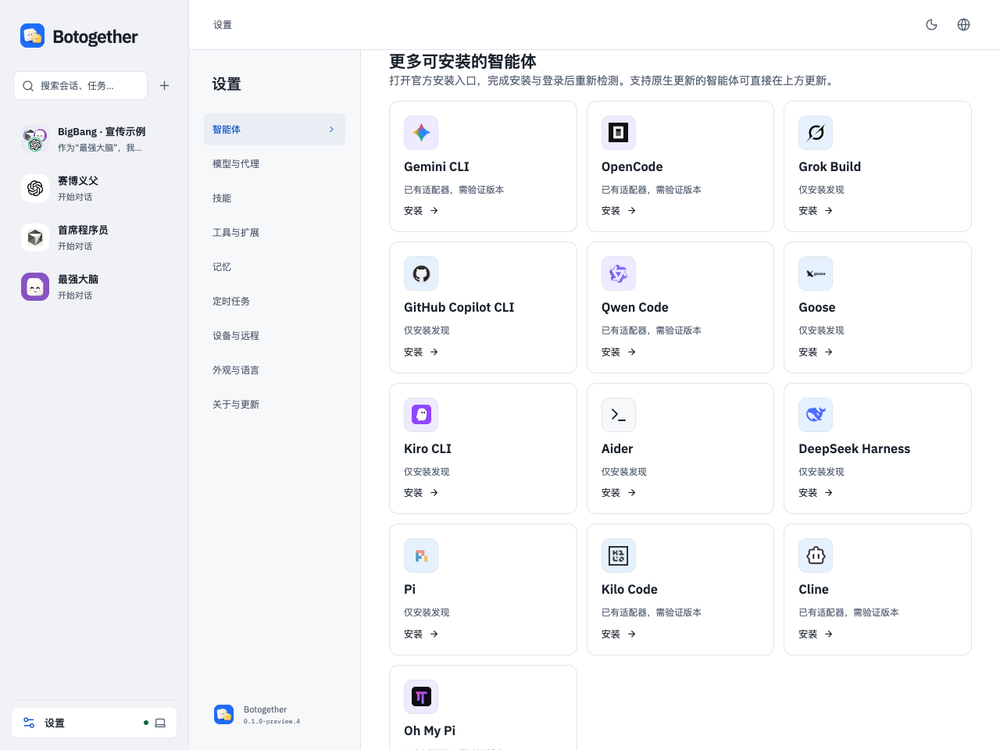
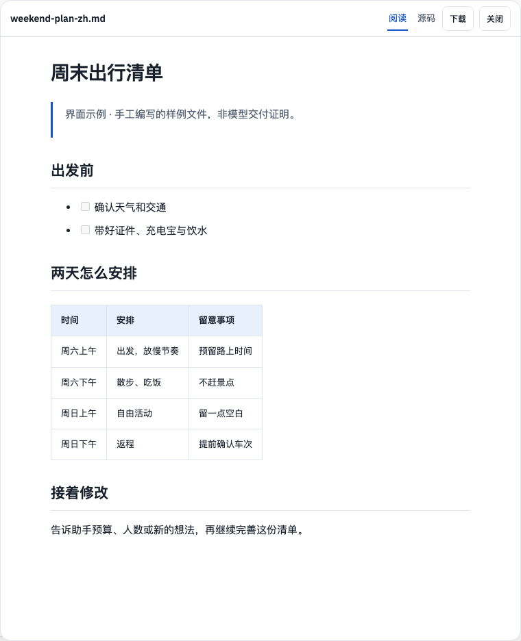

<h1 align="center">Botogether</h1>

<strong>让你的 AI 助手组队做事</strong>

把 Claude Code、Codex、Cursor 等助手拉进同一个项目群聊。 一位动手，一位复查，你来验收交付文件。

简体中文 · <a href="README.en.md">English</a>

  <strong><a href="https://github.com/DmiyDing/botogether/releases/download/v0.1.0-preview.14/Botogether-0.1.0-preview.14-mac-arm64.dmg">下载 Apple 芯片 Mac 版（DMG）</a></strong> 
  <strong><a href="https://github.com/DmiyDing/botogether/releases/download/v0.1.0-preview.14/Botogether-0.1.0-preview.14-win-x64.exe">下载 Windows x64 版（EXE）</a></strong>

<a href="https://github.com/DmiyDing/botogether/releases/tag/v0.1.0-preview.14">preview.14 发行说明</a> · <a href="#安装帮助">安装帮助</a> · <a href="https://github.com/DmiyDing/botogether/releases">所有版本</a>

Botogether 是一款本地优先的 AI 协作桌面应用，支持 Mac 和 Windows。应用免费使用，所选智能体或模型服务可能另行收费。

## 试试让两位助手一起做

> 给这个项目补一份安装指南。请一位助手写初稿，再请另一位对照实际项目，检查命令和步骤。

你也可以让一位助手修改代码，另一位专门检查边界情况和测试覆盖。需要改分工时，直接用 `@` 点名。文件任务完成后，可以打开、预览或下载交付文件。

## 从一个小任务开始

- **已经在用 AI 工具**　打开「设置 → 智能体」，查看本机检测到的工具。用左侧 `+` 创建助手。想试分工，就建一个群聊、选择项目目录并加入至少两位助手。
- **第一次用 AI 工具**　在应用里点「免费开始」，安装 OpenCode，选择当时可用的免费模型。先开一个单聊，让助手为你熟悉的项目整理一份文件，打开结果看看。

[完整入门指南](docs/getting-started.md) · [常见安装问题](docs/troubleshooting.md) · [数据与隐私](docs/privacy.md)

## 界面预览

## 工具、数据和许可

- **接入已有工具**　可接入 Claude Code、Codex CLI、Cursor Agent、OpenCode 等本机工具。登录、模型可用性和费用由所选工具或服务商管理。
- **对话和结果存本机**　Botogether 在本机保存对话、配置与文件快照。使用云端模型时，所选智能体可能把任务所需数据发给对应模型服务。[隐私说明](docs/privacy.md)
- **公开下载和使用指南**　桌面应用按[专有发行许可](LICENSE.md)分发，应用源码由项目维护者私有维护。

## 安装帮助

首次启动被拦截？Mac 与 Windows 操作说明

仅从[官方 Releases](https://github.com/DmiyDing/botogether/releases) 下载，并核对下方校验和。

**Mac：** 打开 DMG，将 Botogether 拖入「应用程序」并尝试打开。如 macOS 拦截，前往「系统设置 → 隐私与安全性」，找到 Botogether 的提示，点击「仍要打开」。[Apple 官方说明](https://support.apple.com/zh-cn/102445)

**Windows：** 运行 EXE。如出现「Windows 已保护你的电脑」，核对来源后点「更多信息 → 仍要运行」。如被 Smart App Control 或单位策略阻止，请保留保护并反馈提示。[Microsoft 官方说明](https://learn.microsoft.com/en-us/windows/apps/package-and-deploy/smartscreen-reputation)

遇到「已损坏」或恶意软件警告，请重新核对下载，不要忽略。

校验和与备用下载

- **Mac ARM64 preview.14：** [ZIP](https://github.com/DmiyDing/botogether/releases/download/v0.1.0-preview.14/Botogether-0.1.0-preview.14-mac-arm64.zip) · [SHA256SUMS](https://github.com/DmiyDing/botogether/releases/download/v0.1.0-preview.14/Botogether-0.1.0-preview.14-mac-arm64-SHA256SUMS.txt)
- **Windows x64 preview.14：** [ZIP](https://github.com/DmiyDing/botogether/releases/download/v0.1.0-preview.14/Botogether-0.1.0-preview.14-win-x64.zip) · [SHA256SUMS](https://github.com/DmiyDing/botogether/releases/download/v0.1.0-preview.14/Botogether-0.1.0-preview.14-win-x64-SHA256SUMS.txt)
- **Intel Mac：** 暂停新构建，保留[历史 preview.7](https://github.com/DmiyDing/botogether/releases/tag/v0.1.0-preview.7)（实验版本）

Mac 核对：`shasum -a 256 文件名`；Windows 核对：`Get-FileHash -Algorithm SHA256 文件名`

---

## 反馈与参与

遇到问题？在 [Issues](https://github.com/DmiyDing/botogether/issues) 里告诉我，附上版本号、系统和复现步骤。Issues 公开可见，请勿上传凭据或私人文件。

[发行许可](LICENSE.md) · [隐私说明](docs/privacy.md) · [项目致谢](docs/getting-started.md#acknowledgments)
