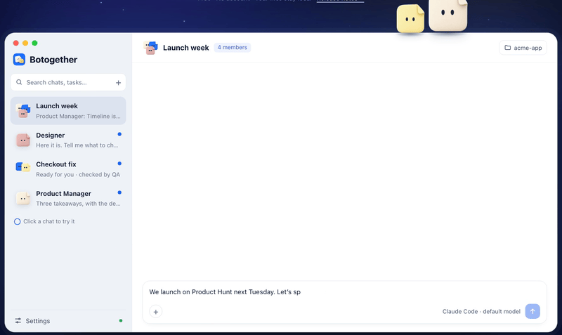
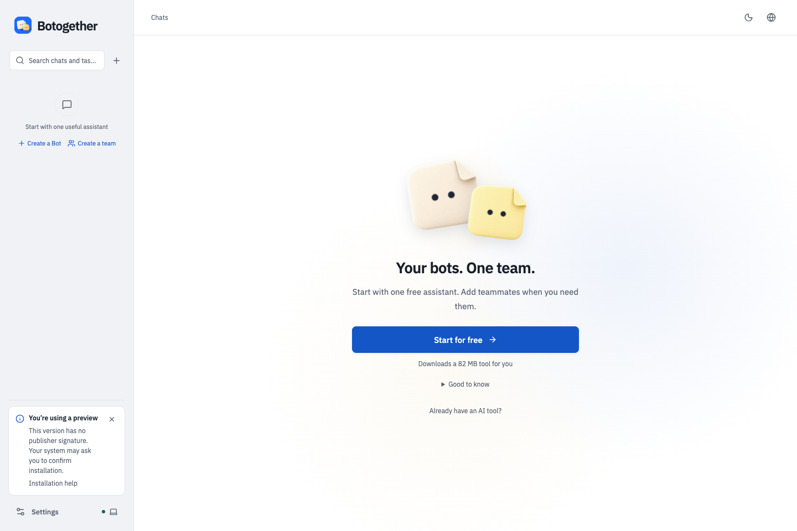
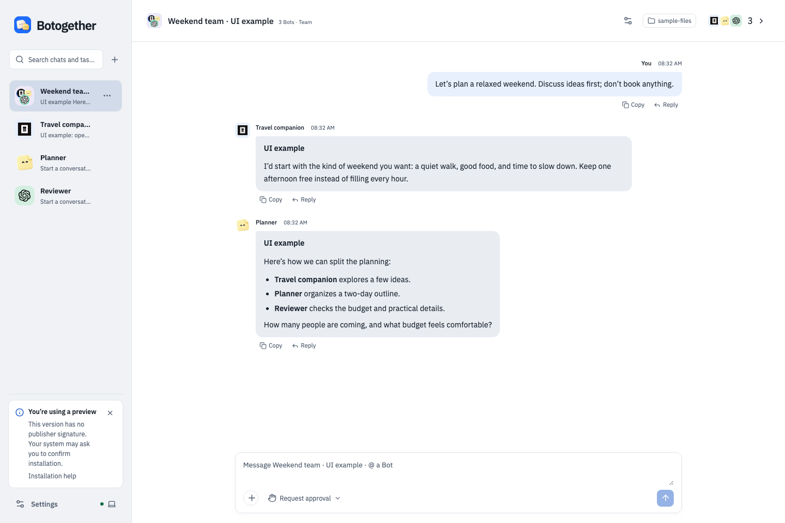
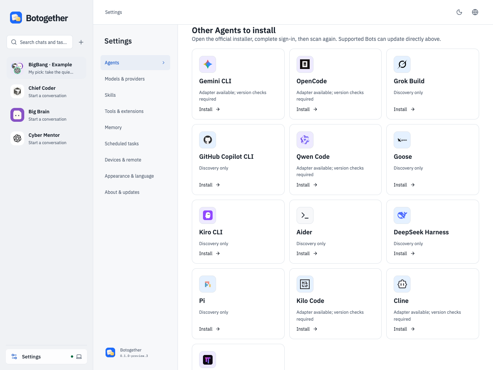
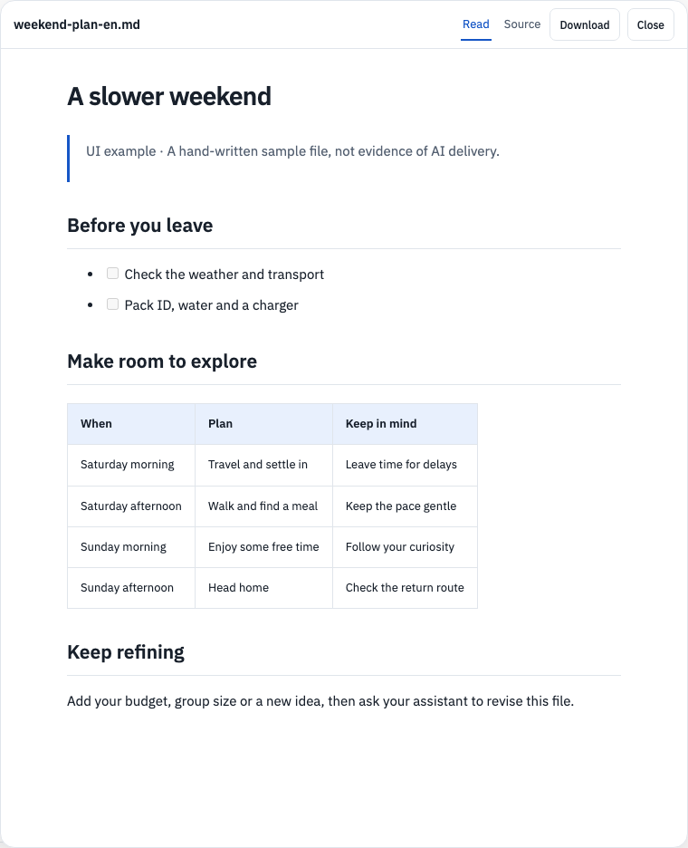

<p align="center"></p>
<h1 align="center">Botogether</h1>
<p align="center"><strong>Your local AI agents, working together as a team.</strong></p>
<p align="center">Mac ARM64 · Windows x64 · Free to start · No subscription</p>
<p align="center"><a href="README.zh-CN.md">简体中文</a></p>

---

You've probably used Claude Code, Codex, OpenCode, or Cursor — but only one at a time, copy-pasting results between them.

**Botogether puts them on the same team.**

You describe the goal. They divide the work, execute it, check each other's output, and hand you something you can actually verify.

```
You: "Implement this feature with tests"
  ↓
Coordinator: breaks down tasks, assigns to the right member
  ↓
Worker:      writes code, commits files
  ↓
Checker:     independent review, reports gaps
  ↓
You get:     a file snapshot with a fixed content digest — not a wall of chat
```

The app is free. Your Agent accounts and model providers charge separately.



---

## Download

**Current version: preview.14**

| Your computer | Installer |
| --- | --- |
| Apple Silicon Mac (M-series) | [Download DMG](https://github.com/DmiyDing/botogether/releases/download/v0.1.0-preview.14/Botogether-0.1.0-preview.14-mac-arm64.dmg) |
| Windows x64 | [Download EXE](https://github.com/DmiyDing/botogether/releases/download/v0.1.0-preview.14/Botogether-0.1.0-preview.14-win-x64.exe) |

[All releases and changelogs →](https://github.com/DmiyDing/botogether/releases)

> **Blocked on first launch? That's expected.** This preview isn't notarized on Mac or signed on Windows. See [Installation help](#installation-help) below.

---

## What it does

**🤝 Multi-agent collaboration**
Assign roles: who writes, who reviews, who integrates. The system coordinates repairs automatically — bounded rounds, no infinite loops.

**💬 Chat interface**
Direct chat and group chat, with `@` to address a member. English and Simplified Chinese, light and dark themes.

**✅ Verifiable results**
File snapshots get a fixed content digest. You can preview and download the actual files. **An Agent saying "done" is not a passed delivery** — you confirm it.

**🔧 Works with your existing tools**
Detects local installations of Claude Code, Codex, OpenCode, Cursor, Antigravity, and more. No re-login required; accounts and billing stay with each provider.

**🏠 Local first**
Standalone background service, SQLite on disk, listens only on localhost. Your conversations and files don't go through Botogether's servers.

---

## Screenshots



No AI tools? Install OpenCode in-app and pick a free model to get started immediately.





---

## Quick start

**Up and running in 5 minutes:**

1. **No Agent installed?** Open the app, choose **Start for free**, install OpenCode, pick a free model.
2. **Already have an Agent?** Go to **Settings → Agents** to detect your installations, then create an assistant.
3. Hit `+` on the left → create an assistant, pick a project folder, describe the goal.
4. Want to try collaboration? Hit `+` → create a group, add two or more assistants, send a task, watch them divide the work.

[Getting started guide](docs/getting-started.md) · [Troubleshooting](docs/troubleshooting.md) · [Privacy](docs/privacy.md)

---

## Supported Agents

| Agent | Status |
| --- | --- |
| OpenCode | ✅ Recommended — in-app install, free models available |
| Claude Code | ✅ Supported — uses your existing account |
| Codex CLI | ✅ Supported |
| Antigravity | ✅ Supported (requires Google account) |
| Cursor | ✅ Supported |
| Gemini CLI | ⚠️ Requires API key or enterprise account |

Capabilities depend on the Agent version and your account. See the [getting started guide](docs/getting-started.md).

---

## FAQ

**Is it free?**
The app has no subscription. Agent accounts and model services have their own terms. OpenCode has a free tier that's enough to try things out.

**Where does my data go?**
Botogether stores everything locally. When you use a cloud model, your task content goes to that model provider — same as using that Agent directly. See [Privacy](docs/privacy.md).

**How is this different from just using Claude Code?**
Claude Code is a powerful single Agent. Botogether orchestrates multiple Agents as a team — each doing what it's best at, with independent checking. It's especially useful for tasks that benefit from multiple rounds or perspectives.

**Is it open source?**
Botogether uses a [proprietary distribution license](LICENSE.md). This repository contains public guides and downloads, not the application source.

---

## Installation help

<details>
<summary>Blocked on first launch? Mac and Windows instructions</summary>

Download only from [official Releases](https://github.com/DmiyDing/botogether/releases) and verify the checksum.

**Mac:** Open the DMG, drag Botogether to Applications, and try opening it. If macOS blocks this preview, go to **System Settings → Privacy & Security** and choose **Open Anyway** when it appears. [Apple's instructions](https://support.apple.com/en-us/102445)

**Windows:** Run the EXE. If "Windows protected your PC" appears, verify the source and choose **More info → Run anyway**. If Smart App Control or an org policy blocks it, keep those protections on and report the warning. [Microsoft's guidance](https://learn.microsoft.com/en-us/windows/apps/package-and-deploy/smartscreen-reputation)

A "damaged" or malware warning means you should re-verify the download — don't dismiss it.

</details>

<details>
<summary>Checksums and ZIP alternatives</summary>

- **Mac ARM64 preview.14:** [ZIP](https://github.com/DmiyDing/botogether/releases/download/v0.1.0-preview.14/Botogether-0.1.0-preview.14-mac-arm64.zip) · [SHA256SUMS](https://github.com/DmiyDing/botogether/releases/download/v0.1.0-preview.14/Botogether-0.1.0-preview.14-mac-arm64-SHA256SUMS.txt)
- **Windows x64 preview.14:** [ZIP](https://github.com/DmiyDing/botogether/releases/download/v0.1.0-preview.14/Botogether-0.1.0-preview.14-win-x64.zip) · [SHA256SUMS](https://github.com/DmiyDing/botogether/releases/download/v0.1.0-preview.14/Botogether-0.1.0-preview.14-win-x64-SHA256SUMS.txt)
- **Intel Mac:** builds are paused; [historical preview.7](https://github.com/DmiyDing/botogether/releases/tag/v0.1.0-preview.7) is experimental and unverified on real Intel hardware.

Verify on Mac: `shasum -a 256 filename` · on Windows: `Get-FileHash -Algorithm SHA256 filename`

</details>

---

## Feedback

Found a bug? Open an [Issue](https://github.com/DmiyDing/botogether/issues) with your version, OS, and steps to reproduce. Issues are public — redact screenshots and never upload credentials or private files.

[License](LICENSE.md) · [Privacy](docs/privacy.md) · [Acknowledgments](docs/getting-started.md#acknowledgments)
