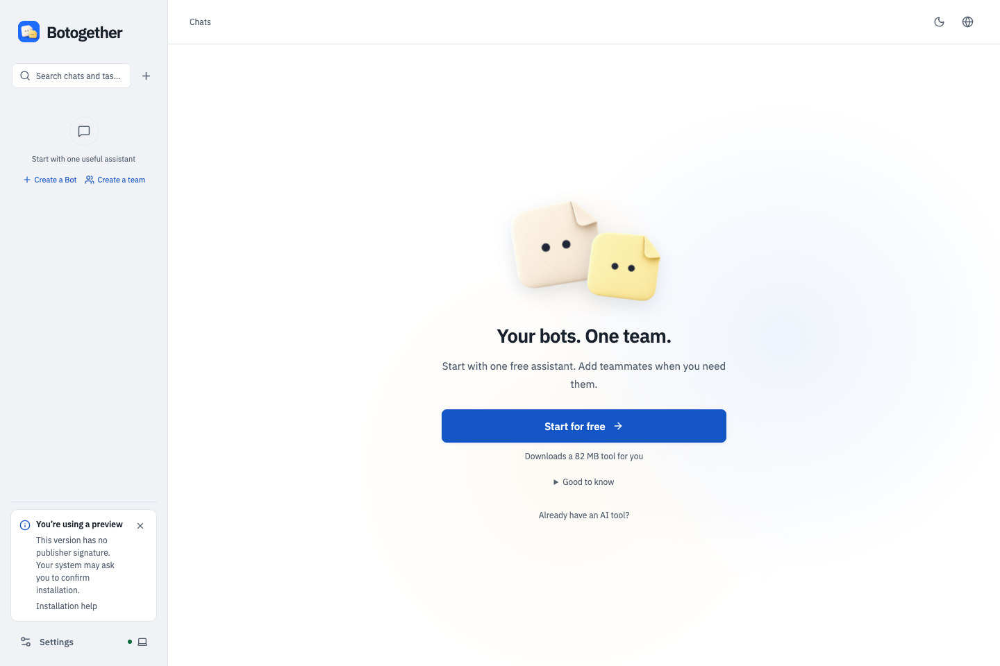
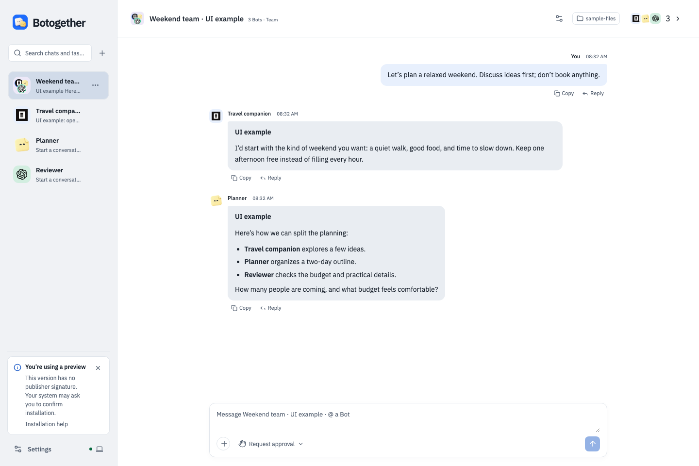
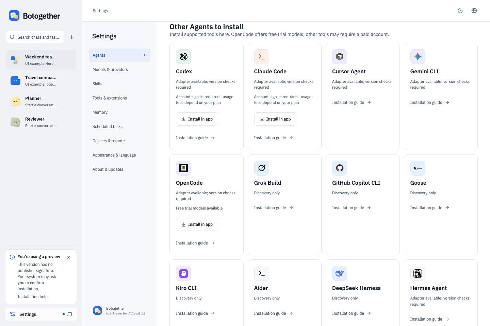
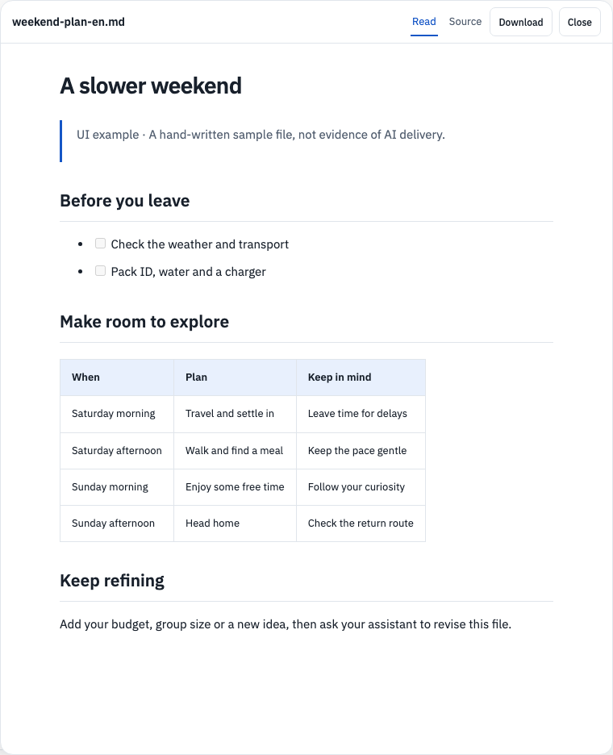

<h1 align="center">Botogether</h1>

<strong>Your bots. One team.</strong> Chat, assign work and inspect results from your local AI agents.

<a href="README.zh-CN.md">简体中文</a> · <a href="https://github.com/DmiyDing/botogether/releases">Downloads</a> · <a href="docs/getting-started.md">Get started</a> · <a href="docs/troubleshooting.md">Help</a>

Botogether brings the coding agents on your computer into direct and group chats. Give each bot a role, choose a project folder, and ask for a result. Your agents execute the work; Botogether keeps conversations, permissions, files and review history together.

**Historical public downloads (unsigned previews):** [Download v0.1.0-preview.7 DMG](https://github.com/DmiyDing/botogether/releases/download/v0.1.0-preview.7/Botogether-0.1.0-preview.7-mac-arm64.dmg). Intel Mac preview.7 is experimental: isolated Rosetta daemon startup passed; native Intel GUI and upgrades remain pending. Windows remains on preview.2; no new Windows package is included. This is an unsigned, unnotarized public preview, not a stable release.

> [!IMPORTANT]
> **First installation blocked? Read this first.** This preview has no Apple Developer ID signature/notarization or Windows publisher signature. Download only from the [official Releases](https://github.com/DmiyDing/botogether/releases) and compare the checksums.
>
> **Mac:** Drag Botogether into Applications and try opening it once → **System Settings → Privacy & Security → Open Anyway** beside the Botogether notice → confirm as prompted and open it again. [Apple's illustrated guide](https://support.apple.com/en-us/102445)
>
> **Windows:** For “Windows protected your PC,” verify the source, then choose **More info → Run anyway** when offered. If the option is missing, or Smart App Control or organizational policy blocks it, stop and report the exact notice; keep protections enabled. [Microsoft guidance](https://learn.microsoft.com/en-us/windows/apps/package-and-deploy/smartscreen-reputation)
>
> Do not disable Gatekeeper, SmartScreen or antivirus. A damaged-app or malware warning calls for checking the download and integrity, not dismissing the warning.

This repository contains download documentation and release assets; application source is private. No private repository access, Node.js or npm is needed to install the desktop app. No npm package has been published.

> **Download status:** All six Mac preview.7 attachments were downloaded anonymously in full and verified against the reviewed byte counts and SHA-256 hashes. Windows remains preview.2; no new Windows build or acceptance is included.

> **V2.3 candidate — not published yet:** Mac Apple Silicon and Windows x64 installers have passed local validation, including native installation, free-model first tasks and upgrades. The screenshots below show local.26. The links below still point to historical public releases; they do not contain all of these changes. Please wait for the new release notes before downloading for the new onboarding flow.

## Why Botogether

- **Free to use.** Botogether adds no app subscription. Your chosen Agent or model provider may charge separately; free model availability and limits are set by that provider.
- **Local first.** Conversations, task records and project context stay on your device. The Agents and services you choose may send prompts or files to their own cloud services.
- **Visible control.** Review permission requests, scope credentials to a service and inspect recorded results. System encryption is available for saved keys; you choose which tools and services to trust.

## Interface preview

Captured from the **V2.3 local.26 interface** in English. These isolated UI examples contain no private conversations. Example dialogue and hand-written files illustrate the interface, not live AI delivery or performance claims.

**No Agent installed? Start for free.** Install OpenCode inside the app, then choose an available free trial model. Paper companions greet, blink and follow the pointer; a still image cannot show the animation.

**Your bots. One team.** Discuss ideas, assign roles and keep the conversation together. This dialogue is clearly marked as a UI example.

**Set up without the detour.** OpenCode, Codex and Claude Code offer in-app installation on supported systems. Other entries have explicit installation guides. Installing an Agent does not include its account or paid model usage.

**Open a file and keep refining.** The current reader renders headings, checklists and tables, with source and download controls. This hand-written sample is not an AI-generated deliverable.

## What you can do

- Chat with a bot, or create a group and use `@` to select one or more members.
- Choose a project folder for each conversation. Group members work toward the same goal in the same folder.
- Assign execution and independent review roles. File tasks keep fixed snapshots for inspection and download; a bot saying “done” does not automatically accept a result.
- Choose models in the composer or bot editor; inspect activity and permissions in task details.
- Save scoped facts and preferences locally. Switching a bot’s model does not erase saved Botogether memories.
- Read formatted answers, preview images fitted to a dialog or at original size, and download original files.
- Use English or Simplified Chinese, with light and dark themes.

## Download and install

| Computer | Download | Installation |
| --- | --- | --- |
| Mac with Apple M-series chip | [v0.1.0-preview.7 DMG](https://github.com/DmiyDing/botogether/releases/download/v0.1.0-preview.7/Botogether-0.1.0-preview.7-mac-arm64.dmg) | Open the DMG, drag Botogether into Applications, then open it from Applications. |
| Mac with Intel processor | [Experimental DMG](https://github.com/DmiyDing/botogether/releases/download/v0.1.0-preview.7/Botogether-0.1.0-preview.7-mac-x64.dmg) | Drag into Applications; preview.7 passed isolated Rosetta startup; native Intel GUI and upgrades remain pending. |
| Windows x64 | [Awaiting the new preview](https://github.com/DmiyDing/botogether/releases) | The V2.3 candidate passed local validation. Historical preview.2 has a known language-resource/blank-window issue; it is not recommended for first use. |

[Release notes](https://github.com/DmiyDing/botogether/releases/tag/v0.1.0-preview.7) · [ZIP alternative](https://github.com/DmiyDing/botogether/releases/download/v0.1.0-preview.7/Botogether-0.1.0-preview.7-mac-arm64.zip) · [SHA256SUMS](https://github.com/DmiyDing/botogether/releases/download/v0.1.0-preview.7/Botogether-0.1.0-preview.7-mac-arm64-SHA256SUMS.txt)

Desktop installers do not require Node.js or npm. Prefer the DMG for your first installation. The automatically generated **Source code** archives contain this distribution repository's documentation, not the application or its private source.

This repository publishes user guides, product screenshots, feedback templates and the distribution license only. Original requirements, designs, development records and internal reviews remain private. Choose a DMG / EXE under Release **Assets**; you do not need the Source code download.

This preview has an ad-hoc integrity signature, without Apple Developer ID or notarization. macOS may block the first launch. Read the [installation help](docs/troubleshooting.md), verify the download source and checksum, and keep system protections enabled.

Check the download with `shasum -a 256 Botogether-0.1.0-preview.7-mac-arm64.dmg` and compare it with the SHA256SUMS file above. A checksum verifies file consistency, not publisher identity.

Intel Mac and Windows alternatives and checksums:

- mac-x64: [ZIP alternative](https://github.com/DmiyDing/botogether/releases/download/v0.1.0-preview.7/Botogether-0.1.0-preview.7-mac-x64.zip) · [SHA256SUMS](https://github.com/DmiyDing/botogether/releases/download/v0.1.0-preview.7/Botogether-0.1.0-preview.7-mac-x64-SHA256SUMS.txt)
- win-x64 (preview.2): [SHA256SUMS](https://github.com/DmiyDing/botogether/releases/download/v0.1.0-preview.2/Botogether-0.1.0-preview.2-win-x64-SHA256SUMS.txt)

On Windows, use PowerShell `Get-FileHash -Algorithm SHA256 filename` to check the download.

## Your first task

The following in-app installation flow is available in the validated V2.3 candidate; historical downloads may not include it.

1. **No AI tools installed:** click **Start for free**. OpenCode downloads and is checked inside the app; no Node.js, npm or terminal is needed.
2. Choose a currently available **free trial model**, then click **Start chatting**. The app rechecks availability and never silently switches to a paid model.
3. **Already have an Agent:** create an assistant and select the detected tool. Complete account sign-in if requested.
4. Try a small task: “Create a weekend checklist.” Open the file, then ask for a revision. Inspect permissions and the actual result.
5. Add teammates when useful. Choose who should prepare the result and who should check it. More members can add usage and coordination costs.

Read [Getting started](docs/getting-started.md), [Help and updates](docs/troubleshooting.md), and [Privacy](docs/privacy.md).

## Updates and boundaries

**Settings → About & updates** checks this repository. Preview builds (alpha/beta/rc) check both prereleases and stable releases; stable builds only check stable updates. Build details show the active channel. Downloads and installation are manual; updating does not silently interrupt running tasks. Quit the old app before installing a new version. Keep one normal installed copy and back up data before upgrading.

Mobile remote control, general plugin installation, complete MCP tool management, automatic memory extraction and autonomous cross-group dispatch are not currently available. Agent capabilities vary by engine and version. Release notes remain the source of truth for supported platforms, signing and known issues.

## Mac preview.7 update

- Team questions appear in chat; service connection failures offer a direct review retry and keep completed files.
- Group role selection checks whether the reviewer can inspect the required files before work starts. Discussion members are shown as discussing.
- Frozen screenshot previews use bounded image context; local HTML and image links open in a restricted preview.
- New-user setup supports an optional private OpenCode installation on Apple Silicon. Model availability and provider policies still apply; Intel and Windows use the official setup guide.
- Continuing beyond the saved Agent-start budget requires explicit confirmation. Task deadlines remain enforced.

Mac preview.7 is published with Apple Silicon and experimental Intel DMG / ZIP installers and checksum files. All six attachments passed anonymous complete download verification. Windows is unchanged because current Actions allowance could not be verified; native Intel GUI/upgrade acceptance remains pending.

## Changes in the Mac preview.6 release

- Both normal service-storage choices accept API keys directly. Existing environment-variable references have a separate advanced entry; no shell plaintext configuration or global Agent configuration is generated.
- Static HTML layout checks use the bundled isolated Electron renderer instead of implicitly starting installed Chrome. Page scripts, external resources, navigation and permissions stay disabled; fixed screenshots, cancellation and process-stop evidence remain checked.
- Identifiable installed-app directory requests require individual confirmation rather than reusable or automatic grants. Third-party native tools retain their own permissions; macOS may still show permission notices for their actions.
- Read notifications persist locally, selected service credentials are prepared before task admission, results and handled permissions are more compact, and image-preview size/download controls share a footer.

Validation: 365 checks passed with 7 conditional skips; 77 browser tests passed with 1 promotional screenshot skip; real isolated rendering passed 3/3 on each Mac architecture. Both packages passed privacy/dependency scans, strict ad-hoc signature integrity, clean authenticated startup/shutdown and DMG/ZIP content matching. Apple Silicon backup upgrade and actual installed GUI identity passed. All six Mac release assets were anonymously downloaded in full and matched the audited bytes and SHA-256 values. Intel native-device GUI/upgrades and a current Windows package remain pending.

Group tasks continue to retain the original goal and declared checks through bounded execution, verification, review and repair. A completed reply does not mean verified delivery. Long mixed-engine workflows remain under validation. OpenCode model availability, limits and data handling depend on the provider; no automatic installation, login or paid-model fallback is implied.

## npm and source

No `npm install` or `npx` command is advertised until a separate audited npm package is published. The private application project is not published wholesale to npm or copied into this download repository.

Long mixed-engine tasks remain under validation. Parallel worktrees, remote access, generic plugins, npm installation and automatic memory extraction are outside this preview.

## Feedback

[Report a problem](https://github.com/DmiyDing/botogether/issues) with the version, operating system, steps and a redacted screenshot. Issues are public. Do not include credentials, chat exports, memory backups or private project files. Third-party licenses and notices ship inside the installer; each component retains its own terms.

## License

Botogether-owned software uses a [proprietary distribution license](LICENSE.md). You may use the official unmodified release for personal or internal business use; private source code is not licensed for redistribution. Third-party components retain their own licenses and notices.

## Release status

The V2.3 local.26 Apple Silicon Mac and Windows x64 candidates passed local native installation, free-model first tasks, package audits and upgrade acceptance. They have not been published; historical download links do not refer to these candidates. Intel Mac and Windows ARM64 were not accepted on native devices in this round. Apple Developer ID / notarization and Windows publisher signing are unavailable; this must be disclosed for a public preview, which is not a production-stable release.

## Acknowledgments

Thanks to these projects for sharing their designs and practices:

- [DeepSeek-Bot](https://github.com/Fei2411/DeepSeek-Bot): Bot interaction, group rounds, and readable memory.
- [douchat](https://github.com/thinkany-ai/douchat): local Agent sessions, approvals, and desktop distribution.
- [orca](https://github.com/stablyai/orca): project workspaces, task ownership, and collaboration interfaces.
- [DeepSeek Harness](https://github.com/deepseek-ai/deepseek-harness): boundaries between a plugin host and session capabilities.
- [Hermes Agent](https://github.com/NousResearch/hermes-agent): long-running conversations and context compression.

These are design references for Botogether's independently implemented features. This acknowledgment does not imply affiliation, endorsement, or that every referenced capability is implemented. Actual dependencies and licenses are listed separately in the installer's third-party notices.
