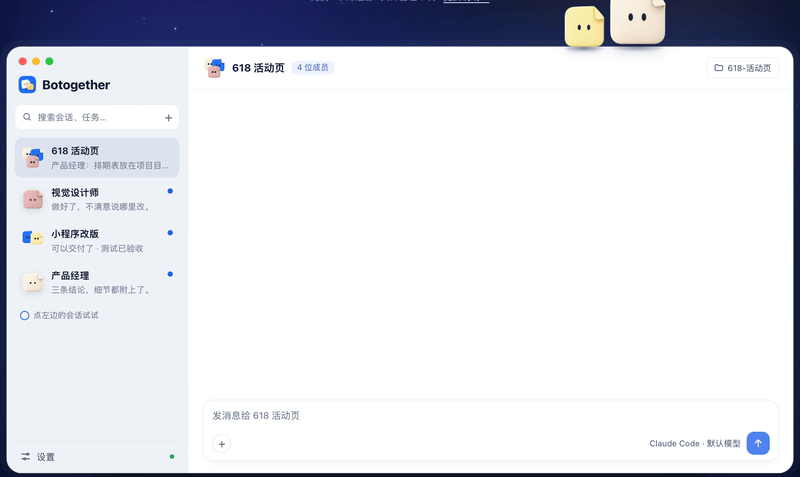
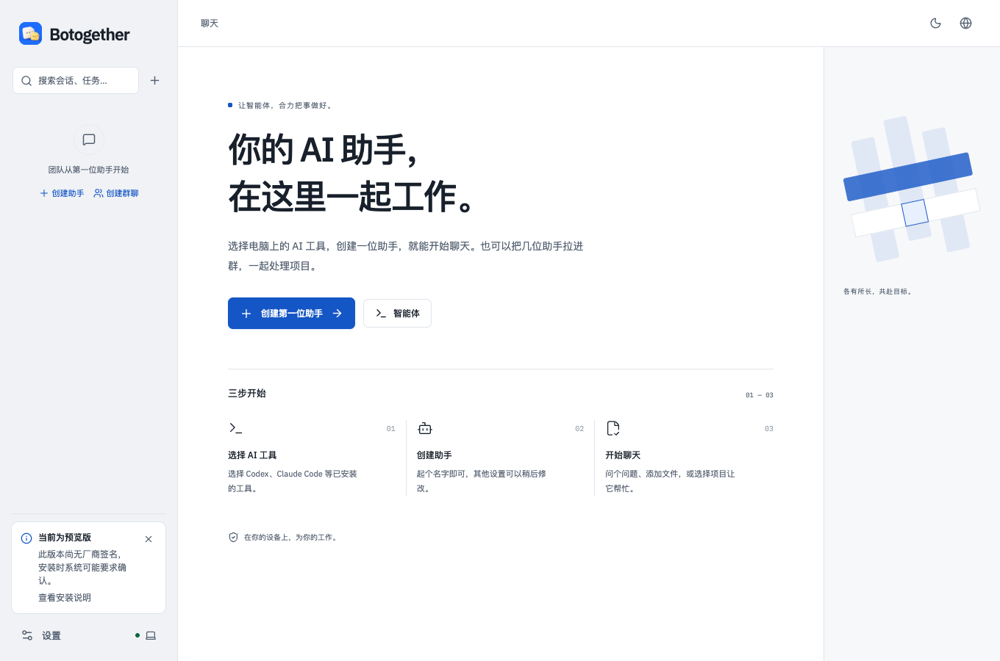
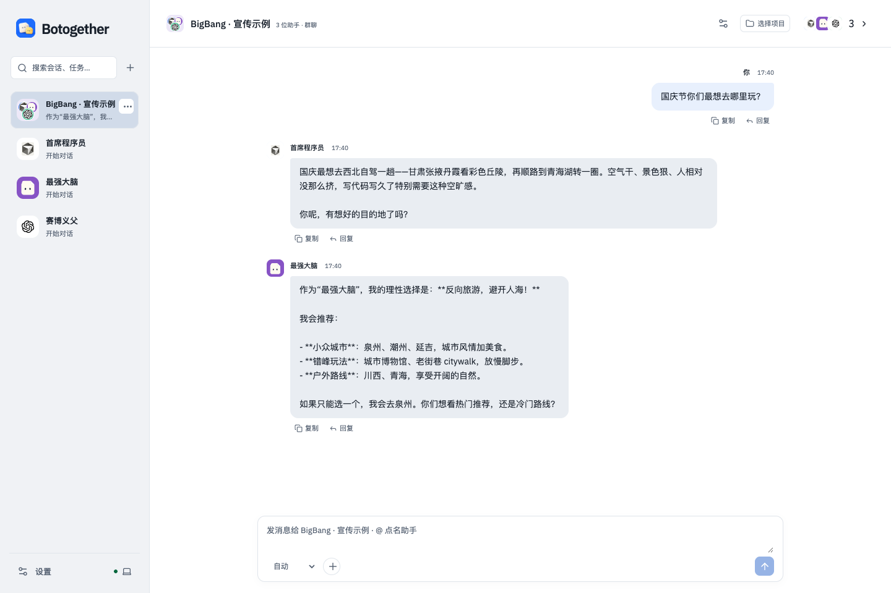
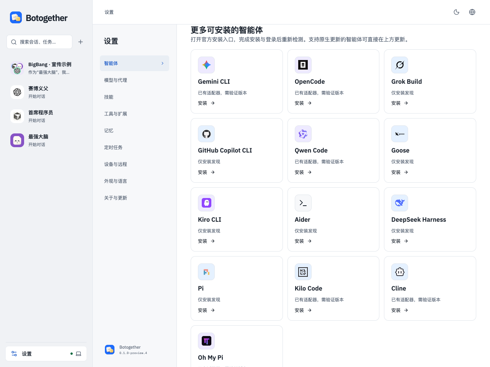

<h1 align="center">Botogether</h1>

<strong>Your bots. One team.</strong> 让智能体，合力把事做好。

<a href="README.md">English</a>

把电脑上的编程智能体变成助手，在私聊或群聊中分工，查看实际文件与成果。Botogether 应用免费，无应用订阅；所选 Agent 或模型服务可能另行收费。

## 下载

| 你的电脑 | 安装包 | 版本 |
| --- | --- | --- |
| Apple Silicon Mac（M芯片） | [下载 DMG](https://github.com/DmiyDing/botogether/releases/download/v0.1.0-preview.12/Botogether-0.1.0-preview.12-mac-arm64.dmg) | preview.12 |
| Windows x64 | [下载 EXE](https://github.com/DmiyDing/botogether/releases/download/v0.1.0-preview.12/Botogether-0.1.0-preview.12-win-x64.exe) | preview.12 |

**测试预览版：** macOS 未公证，Windows 无发布者签名。首次打开请看[安装帮助](#安装帮助)。[版本说明](https://github.com/DmiyDing/botogether/releases)。

## 为什么选择 Botogether

- **同一个聊天，不同的分工。** 让一位助手处理，或由小队制作并检查成果。
- **记录保存在本机。** 会话与任务文件留在你的电脑；所选 Agent 和服务仍可能向其云端发送提示词或文件。
- **权限可见，成果可查。** 选择项目目录，处理授权，查看真实输出。智能体说“完成”不等于交付已通过检查。

## 界面预览

使用隔离数据的界面示例；具体能力取决于所选智能体、模型和工具。

## 第一个任务

1. **还没装 Agent？** 点击“免费开始”，在应用内安装 OpenCode。
2. 选择当前可用的**免费体验模型**。额度与可用性由服务方决定，应用不会静默切到付费模型。
3. **已有 Agent？** 从检测到的安装创建助手；需要时使用原生 Agent 登录。
4. 选择项目文件夹，试试“创建一份周末清单”。打开结果，再要求修改。
5. 需要时添加队友，选择谁制作、谁检查。成员增多可能增加服务用量与协调成本。

[入门指南](docs/getting-started.md) · [问题排查](docs/troubleshooting.md) · [隐私说明](docs/privacy.md)

## 可以做什么

- 私聊、群聊，以及用 `@` 点名成员。
- 共用项目文件夹，保存分工，检查后定向修复。
- 为助手选择模型和作用域内的指令。
- 查看授权、执行记录，处理被中断的任务。
- 预览文件与图片，下载原始文件。
- 使用本地作用域记忆、中英文界面和浅深主题。

当前预览不提供手机远程控制、通用插件安装和完整 MCP 工具管理。各引擎与模型能力不同，实际验证范围见版本说明。

## 常见问题

**免费吗？** 应用没有订阅费；Agent 账号、模型和第三方服务各有自己的条款与价格。

**数据在哪里？** Botogether 记录保存在本机。使用云模型时，任务内容可能发送给对应服务方，详见[隐私说明](docs/privacy.md)。

**支持哪些 Agent？** 应用检测支持的本地安装，并提供安装或配置说明；功能取决于引擎及版本，见[入门指南](docs/getting-started.md)。

**开源吗？** Botogether 使用[专有发行许可](LICENSE.md)。此仓库提供公开说明与下载，不包含应用源码。

## 安装帮助

首次启动被拦截？Mac 与 Windows 操作说明

仅从[官方 Releases](https://github.com/DmiyDing/botogether/releases)下载，并核对下方校验和。

**Mac：** 打开 DMG，将 Botogether 拖入“应用程序”后尝试打开。如 macOS 拦截此预览版，在系统提供选项时，前往“系统设置 → 隐私与安全性”，对这个应用选择“仍要打开”。[Apple 官方说明](https://support.apple.com/zh-cn/102445)。

**Windows：** 运行 EXE。如出现“Windows 已保护你的电脑”，核对来源后，在系统提供选项时选择“更多信息 → 仍要运行”。若 Smart App Control 或单位策略阻止安装，请保留保护并反馈提示。[Microsoft 官方说明](https://learn.microsoft.com/en-us/windows/apps/package-and-deploy/smartscreen-reputation)。

保留 Gatekeeper、SmartScreen 和杀毒软件。遇到“已损坏”或恶意软件警告，应重新核对下载与完整性，不要盲目忽略。完整说明见[问题排查](docs/troubleshooting.md)。

校验和、ZIP 备用下载及其他平台

- **Mac ARM64 preview.12：** [ZIP](https://github.com/DmiyDing/botogether/releases/download/v0.1.0-preview.12/Botogether-0.1.0-preview.12-mac-arm64.zip) · [SHA256SUMS](https://github.com/DmiyDing/botogether/releases/download/v0.1.0-preview.12/Botogether-0.1.0-preview.12-mac-arm64-SHA256SUMS.txt)。
- **Windows x64 preview.12：** [ZIP](https://github.com/DmiyDing/botogether/releases/download/v0.1.0-preview.12/Botogether-0.1.0-preview.12-win-x64.zip) · [SHA256SUMS](https://github.com/DmiyDing/botogether/releases/download/v0.1.0-preview.12/Botogether-0.1.0-preview.12-win-x64-SHA256SUMS.txt)。
- **Intel Mac：** 暂停新构建；保留[历史 preview.7](https://github.com/DmiyDing/botogether/releases/tag/v0.1.0-preview.7)，仍属实验版本，未通过 Intel 真机界面与升级验证。

Mac 使用 `shasum -a 256 文件名`，Windows 使用 `Get-FileHash -Algorithm SHA256 文件名` 与校验表比对。校验和只证明字节一致，不代表发布者身份认证。

桌面安装无需 Node.js 或 npm。请选择 Release **Assets** 中的 DMG 或 EXE；自动生成的 **Source code** 档案只包含本公开仓库的说明资料。当前不提供 npm 安装。

## 反馈与许可

在[问题反馈](https://github.com/DmiyDing/botogether/issues)中提供版本、系统和复现步骤。Issue 公开可见，请遮盖截图中的私人信息，不上传凭据、数据库、聊天导出或私人项目文件。

[发行许可](LICENSE.md) · [隐私说明](docs/privacy.md) · [项目致谢](docs/getting-started.md#acknowledgments)
