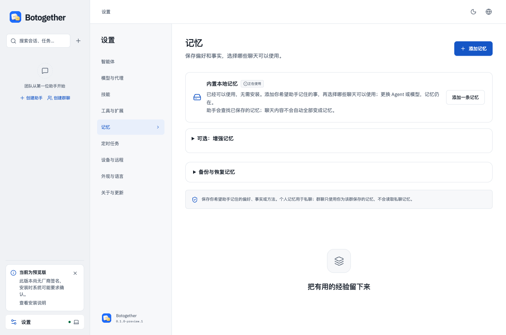
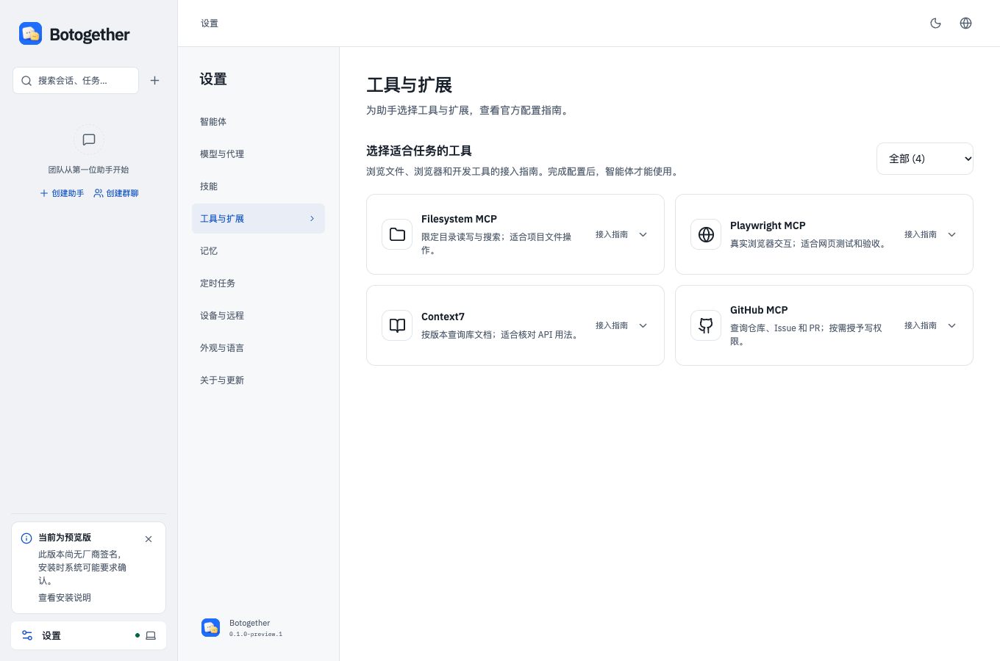

<h1 align="center">Botogether</h1>

<strong>Your bots. One team.</strong> 在一个地方聊天、分工，查看电脑上智能体的执行结果。

<a href="README.md">English</a> · <a href="https://github.com/DmiyDing/botogether/releases">下载安装</a> · <a href="docs/getting-started.md">开始使用</a> · <a href="docs/troubleshooting.md">常见问题</a>

把电脑上的编程智能体变成你的助手。给每位 Bot 设置职责，在私聊或群聊中交代目标，选择项目文件夹，再查看回复、文件和检查结果。

**macOS / Windows 未签名预览版：**[下载 v0.1.0-preview.2 DMG](https://github.com/DmiyDing/botogether/releases/download/v0.1.0-preview.2/Botogether-0.1.0-preview.2-mac-arm64.dmg)。Intel Mac 和 Windows 作为实验性试用包提供，尚待实机安装与升级反馈。本版为未签名、未公证的公开测试预览版，不是稳定版。

此仓库用于安装包和用户说明，应用源码私有。安装桌面包无需私有仓库权限、Node.js 或 npm。目前没有已发布的 npm 包。

> **上传状态：** preview.2 的三平台包已构建并核验，安装附件仍在上传，目前尚不能确认下载。可先使用已核验的 [Apple Silicon preview.1 DMG](https://github.com/DmiyDing/botogether/releases/download/v0.1.0-preview.1/Botogether-0.1.0-preview.1-mac-arm64.dmg)。下方 preview.2 链接须等发布页出现对应安装文件后使用。

## 界面预览

以下为中文模式下、干净隔离工作区的真实界面，不含私人聊天或模拟完成的任务。工具卡片目前提供配置指南，不代表已支持通用一键部署。

## 可以做什么

- 与一个助手聊天，或创建群聊，用 `@` 选择一位或多位成员。
- 为每个会话选择项目文件夹，同一个群聊围绕同一目录和目标协作。
- 指定谁执行、谁独立检查。文件结果保留固定快照，支持查看和下载；助手说“完成”不等于自动验收。
- 在输入框或编辑助手时选择模型，在任务详情查看活动和权限请求。
- 保存有使用范围的偏好与事实，更换 Bot 的模型不会删除 Botogether 已保存的记忆。
- 阅读 Markdown、代码与表格；图片默认适应预览弹窗，也可查看原始尺寸、下载原文件。
- 使用中文或英文界面，选择浅色、深色主题。

## 下载与安装

| 电脑 | 下载 | 怎么安装 |
| --- | --- | --- |
| Apple M 系列芯片 Mac | [v0.1.0-preview.2 DMG](https://github.com/DmiyDing/botogether/releases/download/v0.1.0-preview.2/Botogether-0.1.0-preview.2-mac-arm64.dmg) | 打开 DMG，把 Botogether 拖入 Applications，再从 Applications 打开。 |
| Intel 芯片 Mac | [实验性 DMG](https://github.com/DmiyDing/botogether/releases/download/v0.1.0-preview.2/Botogether-0.1.0-preview.2-mac-x64.dmg) | 拖入 Applications；尚待实机安装与升级验证。 |
| Windows x64 | [实验性 EXE](https://github.com/DmiyDing/botogether/releases/download/v0.1.0-preview.2/Botogether-0.1.0-preview.2-win-x64.exe) | 运行安装程序；未签名，尚待实机界面与升级验证。 |

[版本说明](https://github.com/DmiyDing/botogether/releases/tag/v0.1.0-preview.2) · [备用 ZIP](https://github.com/DmiyDing/botogether/releases/download/v0.1.0-preview.2/Botogether-0.1.0-preview.2-mac-arm64.zip) · [SHA256SUMS 校验文件](https://github.com/DmiyDing/botogether/releases/download/v0.1.0-preview.2/Botogether-0.1.0-preview.2-mac-arm64-SHA256SUMS.txt)

安装桌面包无需 Node.js 或 npm，首次安装建议使用 DMG。GitHub 自动生成的 **Source code** 压缩包仅包含此下载仓库的文档，不是应用安装包，也不包含私有应用源码。

本版已做 ad-hoc 完整性签名，尚无 Apple Developer ID 签名和公证。macOS 可能拦截首次打开，请先阅读[安装帮助](docs/troubleshooting.md)，核对来源和校验和，保留系统安全保护。

运行 `shasum -a 256 Botogether-0.1.0-preview.2-mac-arm64.dmg`，与上面的 SHA256SUMS 文件比较。校验和用于核对文件完整性，不能替代厂商签名。

Intel Mac 与 Windows 备用包和校验文件：

- mac-x64: [ZIP](https://github.com/DmiyDing/botogether/releases/download/v0.1.0-preview.2/Botogether-0.1.0-preview.2-mac-x64.zip) · [SHA256SUMS](https://github.com/DmiyDing/botogether/releases/download/v0.1.0-preview.2/Botogether-0.1.0-preview.2-mac-x64-SHA256SUMS.txt)
- win-x64: [ZIP](https://github.com/DmiyDing/botogether/releases/download/v0.1.0-preview.2/Botogether-0.1.0-preview.2-win-x64.zip) · [SHA256SUMS](https://github.com/DmiyDing/botogether/releases/download/v0.1.0-preview.2/Botogether-0.1.0-preview.2-win-x64-SHA256SUMS.txt)

Windows 可用 PowerShell 的 `Get-FileHash -Algorithm SHA256 文件名` 核对摘要。

## 第一次使用

1. 打开 **设置 → 智能体**，检测本机安装。桌面包不内置 Codex、Claude 或 Cursor。按界面中的官方指南安装并登录，再回来检测。
2. 从左侧 `+` 菜单创建助手，填写名称，选择可用的本地智能体。
3. 打开聊天，选择项目文件夹。先试：“阅读这个项目，列出三个改进建议，暂时不要改文件。”
4. 发送消息，在需要时查看并批准权限。模型服务由所选智能体或服务商计费，安装包不包含模型额度。
5. 查看回复和文件。需要协作时创建群聊，选成员和共享目录，再明确谁编码、谁评审。

详细步骤见[使用指南](docs/getting-started.md)、[问题排查与更新](docs/troubleshooting.md)、[隐私说明](docs/privacy.md)。

## 更新与当前边界

在 **设置 → 关于与更新** 检查此仓库的更新。preview／alpha／beta 等测试版检查测试版及稳定版，稳定版只检查稳定更新；当前通道可在构建详情查看。下载和安装由你决定，不会为更新自动中断任务。安装新版前退出旧应用，保留一个正常安装入口，并备份数据。

手机远程、通用插件安装、完整 MCP 工具管理、记忆自动提取和主助手跨群自动派发目前尚不可用。智能体能力随引擎和版本变化；平台、签名和已知问题以对应版本说明为准。

## npm 与源码

npm 包尚未发布，因此不提供无法使用的 `npm install` 或 `npx` 命令。以后若提供 npm 安装，会采用单独审核的包，不把私有源码项目整体发布到 npm 或此下载仓库。

长时间三引擎任务仍在验证。本版不提供并行 worktree、手机远程、通用插件、npm 安装或自动记忆提取。

## 反馈

在应用“关于与更新”点击“导出诊断并反馈”，先检查脱敏摘要，再自行提交 Issue。也可以在[问题反馈](https://github.com/DmiyDing/botogether/issues)说明版本、操作系统和复现步骤，截图应遮盖私人信息。Issue 公开可见。不要上传密钥、聊天导出、记忆备份或私有项目文件。安装包附带第三方许可与 notices，各组件保留其对应条款。

## 许可证

Botogether 自有软件使用[专有发行许可证](LICENSE.md)。允许使用官方未修改版本，供个人或企业内部使用；不授予私有源码分发权。第三方组件保留各自许可与 notices。

## 发布状态

三平台为公开测试预览版。Apple Silicon Mac 已有本机安装证据；Intel Mac / Windows 的 CI 构建和包启动检查不替代实机界面与升级验收。当前没有 Apple Developer ID／公证或 Windows 厂商签名条件。
