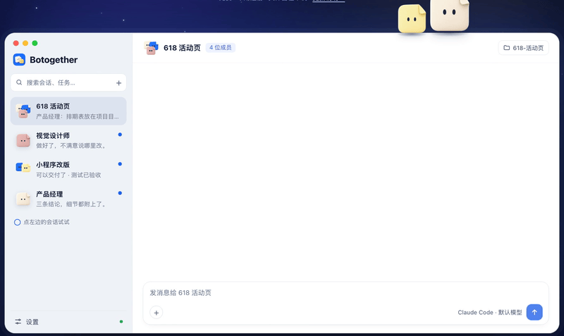
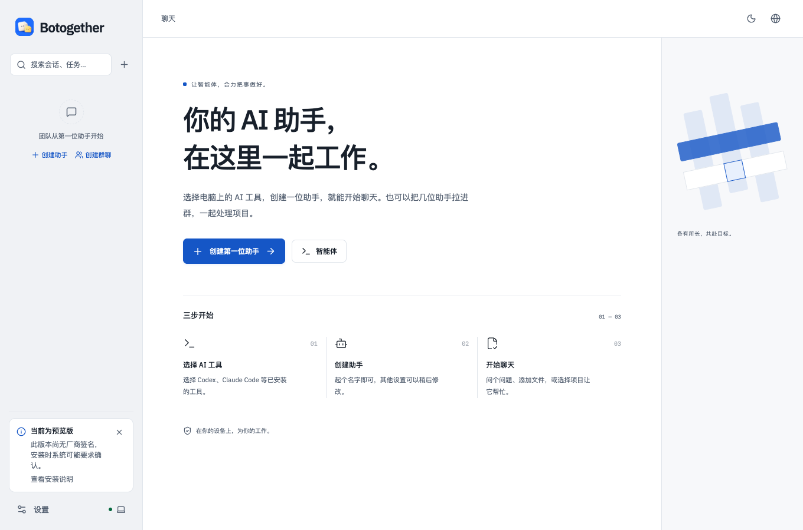
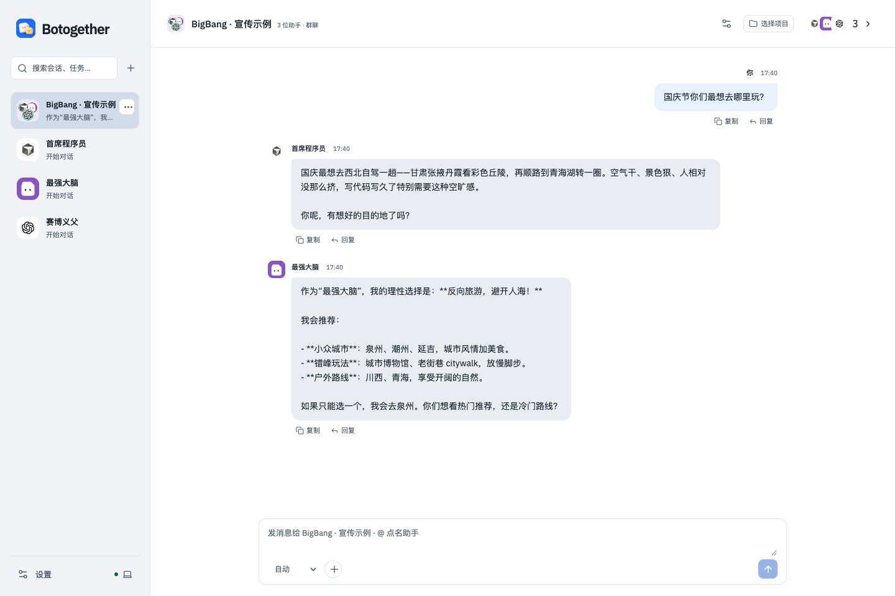
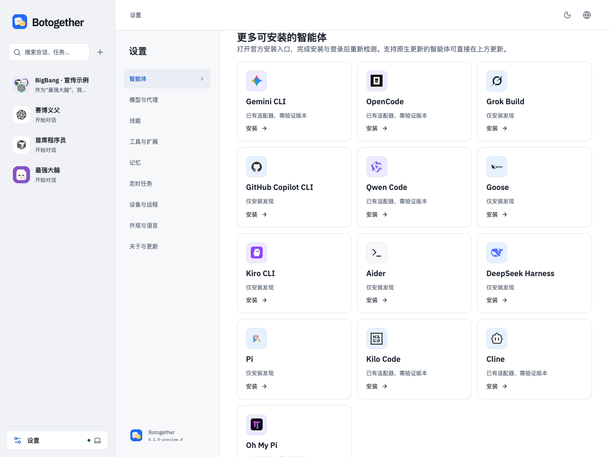
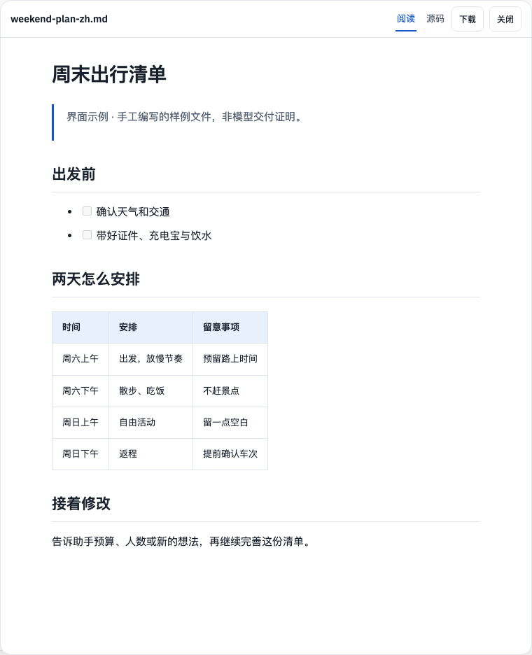

<p align="center"></p>
<h1 align="center">Botogether</h1>
<p align="center"><strong>让你电脑上的 AI 智能体，像团队一样协作。</strong></p>
<p align="center">Mac ARM64 · Windows x64 · 免费开始 · 无需订阅</p>
<p align="center"><a href="README.md">English</a></p>

---

你可能已经用过 Claude Code、Codex、OpenCode 或 Cursor——但每次只能跟一个对话，做完一步再复制给下一个。

**Botogether 把它们变成一支团队。**

你说目标，它们分工、执行、互相检查，把可核对的结果交给你。

```
你说："帮我实现这个功能，要有测试"
  ↓
协调者：拆分任务，分配给最合适的成员
  ↓
执行者：写代码，提交文件
  ↓
检查者：独立审核，报告缺漏
  ↓
你拿到：固定了内容摘要的文件快照，不是一堆对话截图
```

应用免费，无订阅。所选 Agent 或模型服务可能另行收费。



---

## 下载安装

**当前版本：preview.14**

| 你的电脑 | 安装包 | 
| --- | --- |
| Apple Silicon Mac（M 芯片） | [下载 DMG](https://github.com/DmiyDing/botogether/releases/download/v0.1.0-preview.14/Botogether-0.1.0-preview.14-mac-arm64.dmg) |
| Windows x64 | [下载 EXE](https://github.com/DmiyDing/botogether/releases/download/v0.1.0-preview.14/Botogether-0.1.0-preview.14-win-x64.exe) |

[查看所有版本和更新说明 →](https://github.com/DmiyDing/botogether/releases)

> **首次打开被系统拦截？这是正常的。** 当前预览版没有 Apple 公证和 Windows 签名，详见下方[安装帮助](#安装帮助)。

---

## 核心功能

**🤝 多 Agent 协作**
给每个助手设定职责：谁负责写代码、谁负责检查、谁负责整合。任务有界返工，不会无限循环。

**💬 像聊天一样用**
私聊、群聊、`@` 点名，和平时用的聊天软件一样直觉。支持中英文、浅色深色主题。

**✅ 结果可以核对**
文件快照固定内容摘要，支持预览和下载。**模型说"完成"不等于任务通过**，你最终确认。

**🔧 用你已有的工具**
对接本机已安装的 Claude Code、Codex、OpenCode、Cursor、Antigravity 等。不需要重新登录，账号和费用由对应服务管理。

**🏠 本地优先，数据不出门**
独立后台服务，SQLite 本地存储，只监听本机地址。你的对话和文件不经过 Botogether 的服务器。

---

## 界面预览



没有 AI 工具？在应用内一键安装 OpenCode，选 DeepSeek 或 GLM 免费模型直接开始。





---

## 快速上手

**第一次使用，5 分钟内跑起来：**

1. **没有 AI 工具？** 打开应用，首页点「免费开始」，一键安装 OpenCode，选一个免费模型。
2. **已有工具？** 「设置 → 智能体」检测已安装的工具，创建助手，绑定模型服务。
3. 左侧 `+` → 创建助手，选一个项目文件夹，说明目标，等结果。
4. 想体验协作：左侧 `+` → 创建群聊，选两位以上助手，发出任务，看它们怎么分工。

[完整入门指南](docs/getting-started.md) · [遇到问题？](docs/troubleshooting.md) · [隐私说明](docs/privacy.md)

---

## 支持哪些 Agent

| Agent | 状态 |
| --- | --- |
| OpenCode | ✅ 推荐，可应用内安装，有免费模型 |
| Claude Code | ✅ 支持，使用你已有的账号 |
| Codex CLI | ✅ 支持 |
| Antigravity | ✅ 支持（需要 Google 账号） |
| Cursor | ✅ 支持 |
| Gemini CLI | ⚠️ 需要 API key 或企业账号 |

功能取决于 Agent 版本和你的账号权限；详见[入门指南](docs/getting-started.md)。

---

## 常见问题

**免费吗？**
应用本身没有订阅费。Agent 账号和模型服务各有自己的条款；OpenCode 有免费额度，够日常体验用。

**数据安全吗？**
Botogether 记录只存在你本机。使用云端模型时，任务内容会发给对应服务方（和你直接用那个 Agent 一样）。详见[隐私说明](docs/privacy.md)。

**和直接用 Claude Code 有什么区别？**
Claude Code 是一个很强的单个 Agent。Botogether 把多个 Agent 组成团队，让它们分工、互相验证——特别适合需要多轮、多角度完成的任务。

**开源吗？**
应用使用[专有发行许可](LICENSE.md)。这个仓库提供公开说明和下载，不包含应用源码。

---

## 安装帮助

<details>
<summary>首次启动被拦截？Mac 与 Windows 操作说明</summary>

仅从[官方 Releases](https://github.com/DmiyDing/botogether/releases) 下载，并核对下方校验和。

**Mac：** 打开 DMG，将 Botogether 拖入「应用程序」并尝试打开。如 macOS 拦截，前往「系统设置 → 隐私与安全性」，找到 Botogether 的提示，点击「仍要打开」。[Apple 官方说明](https://support.apple.com/zh-cn/102445)

**Windows：** 运行 EXE。如出现「Windows 已保护你的电脑」，核对来源后点「更多信息 → 仍要运行」。如被 Smart App Control 或单位策略阻止，请保留保护并反馈提示。[Microsoft 官方说明](https://learn.microsoft.com/en-us/windows/apps/package-and-deploy/smartscreen-reputation)

遇到「已损坏」或恶意软件警告，请重新核对下载，不要忽略。

</details>

<details>
<summary>校验和与备用下载</summary>

- **Mac ARM64 preview.14：** [ZIP](https://github.com/DmiyDing/botogether/releases/download/v0.1.0-preview.14/Botogether-0.1.0-preview.14-mac-arm64.zip) · [SHA256SUMS](https://github.com/DmiyDing/botogether/releases/download/v0.1.0-preview.14/Botogether-0.1.0-preview.14-mac-arm64-SHA256SUMS.txt)
- **Windows x64 preview.14：** [ZIP](https://github.com/DmiyDing/botogether/releases/download/v0.1.0-preview.14/Botogether-0.1.0-preview.14-win-x64.zip) · [SHA256SUMS](https://github.com/DmiyDing/botogether/releases/download/v0.1.0-preview.14/Botogether-0.1.0-preview.14-win-x64-SHA256SUMS.txt)
- **Intel Mac：** 暂停新构建，保留[历史 preview.7](https://github.com/DmiyDing/botogether/releases/tag/v0.1.0-preview.7)（实验版本）

Mac 核对：`shasum -a 256 文件名`；Windows 核对：`Get-FileHash -Algorithm SHA256 文件名`

</details>

---

## 反馈与参与

遇到问题？在 [Issues](https://github.com/DmiyDing/botogether/issues) 里告诉我，附上版本号、系统和复现步骤。Issues 公开可见，请勿上传凭据或私人文件。

[发行许可](LICENSE.md) · [隐私说明](docs/privacy.md) · [项目致谢](docs/getting-started.md#acknowledgments)
