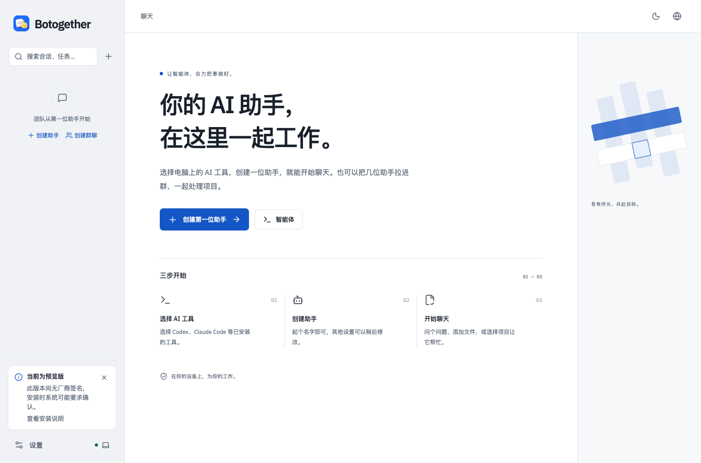
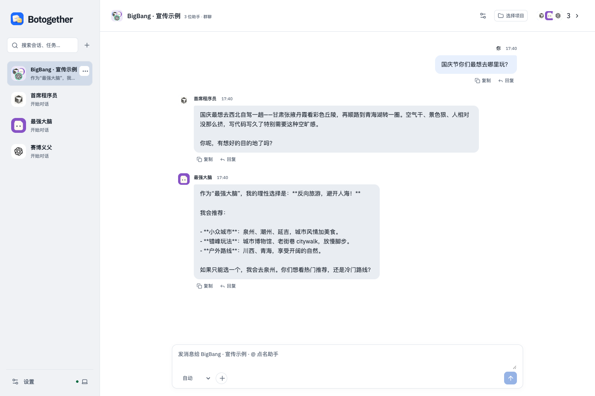
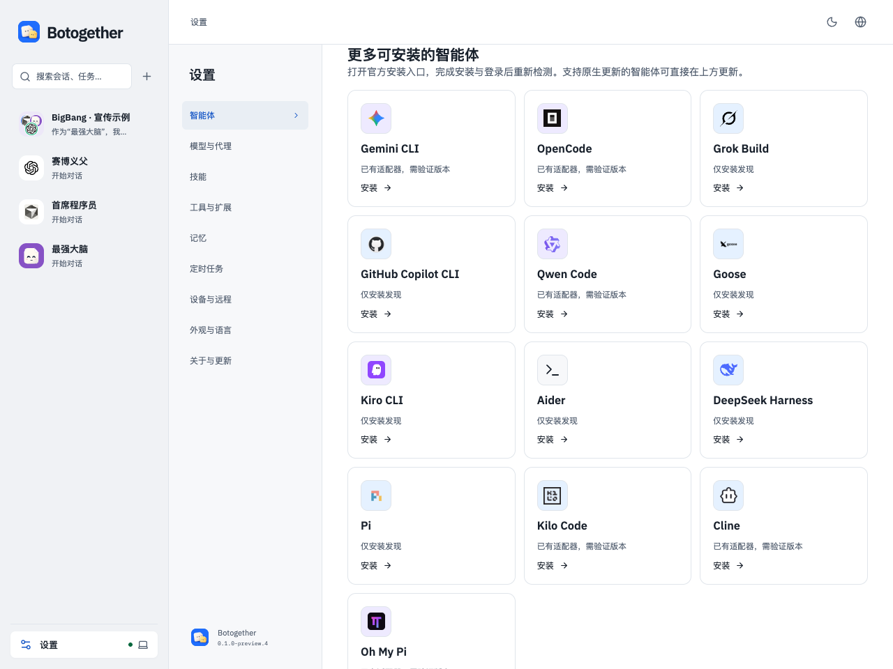
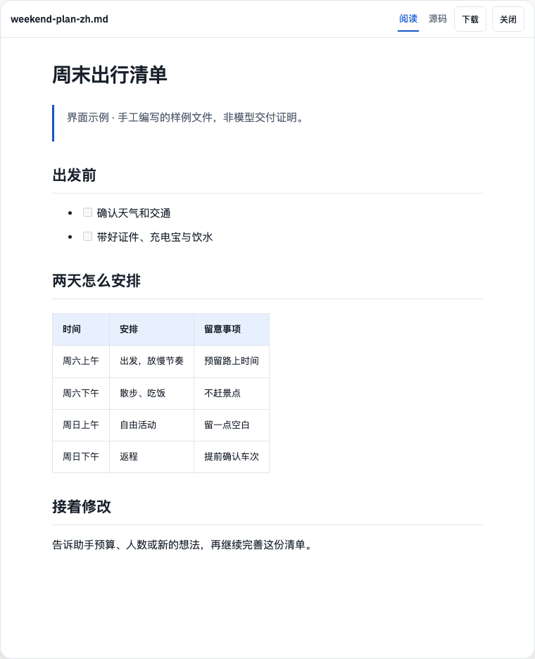

<h1 align="center">Botogether</h1>

<strong>Your bots. One team.</strong> 让智能体，合力把事做好。

<a href="README.md">English</a> · <a href="https://github.com/DmiyDing/botogether/releases">下载安装</a> · <a href="docs/getting-started.md">开始使用</a> · <a href="docs/troubleshooting.md">常见问题</a>

把电脑上的编程智能体变成你的助手。给每位 Bot 设置职责，在私聊或群聊中交代目标，选择项目文件夹，再查看回复、文件和检查结果。

**未签名 preview.8：**[Apple Silicon Mac DMG](https://github.com/DmiyDing/botogether/releases/download/v0.1.0-preview.8/Botogether-0.1.0-preview.8-mac-arm64.dmg) · [Windows x64 安装包](https://github.com/DmiyDing/botogether/releases/download/v0.1.0-preview.8/Botogether-0.1.0-preview.8-win-x64.exe)。本轮不含新版 Intel Mac。这是未签名、未公证的公开测试预览版，不是稳定版。

> [!IMPORTANT]
> **首次安装被系统拦截？请先看这里。** 当前预览版尚无 Apple Developer ID 签名／公证，也没有 Windows 厂商签名。请仅从[官方 Releases](https://github.com/DmiyDing/botogether/releases)下载并核对校验和。
>
> **Mac：** 将 Botogether 拖入“应用程序”并尝试打开一次 → 打开 **系统设置 → 隐私与安全性** → 找到 Botogether 的拦截提示，点击 **“仍要打开”** → 按系统要求确认后再次打开。[Apple 图文说明](https://support.apple.com/zh-cn/102445)
>
> **Windows：** 如果出现“Windows 已保护你的电脑”，核对来源后点击 **“更多信息” → “仍要运行”**。如果没有该按钮，或被 Smart App Control／单位策略阻止，请停止安装并反馈具体提示，保留系统保护。[Microsoft 说明](https://learn.microsoft.com/en-us/windows/apps/package-and-deploy/smartscreen-reputation)
>
> 不需要关闭 Gatekeeper、SmartScreen 或杀毒软件。提示“已损坏”或“包含恶意软件”时，请重新核对下载与完整性，不要直接忽略警告。

此仓库用于安装包和用户说明，应用源码私有。安装桌面包无需私有仓库权限、Node.js 或 npm。目前没有已发布的 npm 包。

> **下载状态：** preview.8 的 Apple Silicon Mac 与 Windows x64 六个附件均已匿名完整下载，并核对审核版本的字节数和 SHA-256。

> **已验收平台：** Mac ARM64 与 Windows x64 已通过本地原生安装、实际界面、包审计和已有数据升级检查。其他架构与全部模型／账号组合不在本轮已验证范围。

## 为什么选择 Botogether

- **应用免费用。** Botogether 本身不收取应用订阅费；所选 Agent、模型或第三方服务可能另行收费，免费模型的额度与可用性由服务方决定。
- **数据留在本机。** 会话、任务记录与项目上下文保存在你的电脑上；你选择的 Agent 和模型服务仍可能将提示词或文件发送到其云端。
- **权限看得见，结果可检查。** 查看并控制执行授权，按服务管理密钥，保留任务记录和结果证据；保存密钥可使用系统加密。工具、服务和授权范围由你选择。

## 界面预览

以下是 **V2.3 local.26 的历史界面示例**，使用隔离数据，不含私人聊天。preview.8 简化了助手招呼，并包含下方列出的更新。示例对话及手写文件用于展示界面，不代表真实模型交付或效果承诺。

**没有装过 AI 工具？点“免费开始”。** 在应用内安装 OpenCode，再选择当前可用的免费体验模型。折纸精灵会迎接、眨眼和跟随鼠标，静态截图无法呈现动画。

**一支 AI 小队，一起把事做好。** 在同一个群聊中讨论、点名和分工。图中对话已明确标为界面示例。

**准备工具，少绕一步。** 支持的系统可一键安装 OpenCode、Codex、Claude Code；其他工具明确提供安装说明。安装程序不等于赠送账号或付费模型额度。

**点开文件，就能阅读。** 当前阅读器支持标题、清单和表格，可切换源码、下载，再回到聊天继续修改。这是手工编写的样例文件，不是 AI 生成成果。

## 可以做什么

- 与一个助手聊天，或创建群聊，用 `@` 选择一位或多位成员。
- 为每个会话选择项目文件夹，同一个群聊围绕同一目录和目标协作。
- 指定谁执行、谁独立检查。文件结果保留固定快照，支持查看和下载；助手说“完成”不等于自动验收。
- 在输入框或编辑助手时选择模型，在任务详情查看活动和权限请求。
- 保存有使用范围的偏好与事实，更换 Bot 的模型不会删除 Botogether 已保存的记忆。
- 阅读 Markdown、代码与表格；图片默认适应预览弹窗，也可查看原始尺寸、下载原文件。
- 使用中文或英文界面，选择浅色、深色主题。

## 下载与安装

| 电脑 | 下载 | 怎么安装 |
| --- | --- | --- |
| Apple M 系列芯片 Mac | [v0.1.0-preview.8 DMG](https://github.com/DmiyDing/botogether/releases/download/v0.1.0-preview.8/Botogether-0.1.0-preview.8-mac-arm64.dmg) | 打开 DMG，把 Botogether 拖入 Applications，再从 Applications 打开。 |
| Intel 芯片 Mac（历史 preview.7） | [实验性 DMG](https://github.com/DmiyDing/botogether/releases/download/v0.1.0-preview.7/Botogether-0.1.0-preview.7-mac-x64.dmg) | 拖入 Applications；preview.7 仅通过 Rosetta 隔离启动检查。本轮没有 Intel 更新，Intel 原生界面与升级仍待验证。 |
| Windows x64 | [v0.1.0-preview.8 安装包](https://github.com/DmiyDing/botogether/releases/download/v0.1.0-preview.8/Botogether-0.1.0-preview.8-win-x64.exe) | 运行安装程序并按提示完成；当前没有厂商签名，请先看上方安装帮助。 |

[版本说明](https://github.com/DmiyDing/botogether/releases/tag/v0.1.0-preview.8) · [备用 ZIP](https://github.com/DmiyDing/botogether/releases/download/v0.1.0-preview.8/Botogether-0.1.0-preview.8-mac-arm64.zip) · [SHA256SUMS 校验文件](https://github.com/DmiyDing/botogether/releases/download/v0.1.0-preview.8/Botogether-0.1.0-preview.8-mac-arm64-SHA256SUMS.txt)

安装桌面包无需 Node.js 或 npm，首次安装建议使用 DMG。GitHub 自动生成的 **Source code** 压缩包仅包含此下载仓库的文档，不是应用安装包，也不包含私有应用源码。

本仓库仅公开使用说明、产品截图、反馈模板及发行许可。原始需求、设计方案、研发记录和内部审查文档均保留在私有仓库。请从 Release 的 **Assets** 选择 DMG / EXE；无需下载 Source code。

Mac 版已做 ad-hoc 完整性签名，尚无 Apple Developer ID 签名和公证；Windows 版仍无厂商签名。macOS 可能拦截首次打开，请先阅读[安装帮助](docs/troubleshooting.md)，核对来源和校验和，保留系统安全保护。

运行 `shasum -a 256 Botogether-0.1.0-preview.8-mac-arm64.dmg`，与上面的 SHA256SUMS 文件比较。校验和用于核对文件完整性，不能替代厂商签名。

Intel Mac 与 Windows 备用包和校验文件：

- mac-x64: [备用 ZIP](https://github.com/DmiyDing/botogether/releases/download/v0.1.0-preview.7/Botogether-0.1.0-preview.7-mac-x64.zip) · [SHA256SUMS](https://github.com/DmiyDing/botogether/releases/download/v0.1.0-preview.7/Botogether-0.1.0-preview.7-mac-x64-SHA256SUMS.txt)
- win-x64：[备用 ZIP](https://github.com/DmiyDing/botogether/releases/download/v0.1.0-preview.8/Botogether-0.1.0-preview.8-win-x64.zip) · [SHA256SUMS](https://github.com/DmiyDing/botogether/releases/download/v0.1.0-preview.8/Botogether-0.1.0-preview.8-win-x64-SHA256SUMS.txt)

Windows 可用 PowerShell 的 `Get-FileHash -Algorithm SHA256 文件名` 核对摘要。

## 第一次使用

以下应用内安装流程已在 V2.3 候选验收，历史下载版本请以对应发行说明为准。

1. **没装过 AI 工具：** 首页点 **免费开始**。保持应用打开，等待 OpenCode 下载和检查，不需要 Node.js、npm 或终端。
2. 选择当前可用的 **免费体验模型**，点 **开始聊天**。免费名额会变化，应用会重新检查，不会悄悄切换付费模型。
3. **已有 AI 工具：** 直接创建助手，选择检测到的工具；需要账号时按工具提示登录。
4. 先试一个小任务：“帮我做一份周末出行清单。”点开文件检查，再补一句继续修改。执行前留意权限，完成后核对结果。
5. 需要协作时再组队，选谁制作、谁核对。成员更多会增加用量与协调成本，不保证更快。

详细步骤见[使用指南](docs/getting-started.md)、[安装帮助](docs/troubleshooting.md)、[隐私说明](docs/privacy.md)。

## 更新与当前边界

在 **设置 → 关于与更新** 检查此仓库的更新。preview／alpha／beta 等测试版检查测试版及稳定版，稳定版只检查稳定更新；当前通道可在构建详情查看。下载和安装由你决定，不会为更新自动中断任务。安装新版前退出旧应用，保留一个正常安装入口，并备份数据。

手机远程、通用插件安装、完整 MCP 工具管理、记忆自动提取和主助手跨群自动派发目前尚不可用。智能体能力随引擎和版本变化；平台、签名和已知问题以对应版本说明为准。

## preview.8 更新

- 群聊保留原生 Agent 工具能力；实际联网和执行仍取决于所选工具、模型与授权。
- 支持的连接可在输入时准备，不提前发送草稿或运行模型任务。
- 多个待授权操作逐项展示；创建助手时可直接看到头像和颜色。
- 新助手默认“小助 / Buddy”，用简短招呼引导交流；上下文和选定目录处理也有改进。
- Windows 补齐语言资源与五种尺寸图标；所选双平台均通过本地包、真实界面与已有数据升级检查。

外部工具延迟和免费模型可用性仍会变化，本版不宣称整体提速或生产稳定性。

## Mac preview.6 改进

- 普通两种保存方式都直接填写 API Key。引用已有环境变量放在独立高级入口；不会生成 shell 明文配置或修改 Agent 全局配置。
- 静态 HTML 布局检查改用包内隔离 Electron，不再默认启动已安装 Chrome。页面脚本、外部资源、导航和权限禁用，保留固定截图、取消与进程停止验证。
- 可识别的已安装应用目录请求需单次确认，不继承自动或复用授权。第三方原生工具仍有自己的权限，macOS 仍可能因其行为显示权限通知。
- 已读通知持久化，任务入队前准备选定服务凭据；结果和已处理授权更紧凑，图片预览的尺寸与下载操作放在同一底栏。

验收：完整检查365通过、7项条件跳过；浏览器77通过、1项宣传截图默认跳过；两架构实际包隔离渲染各3/3。两包的隐私/依赖扫描、严格ad-hoc签名完整性、空数据认证启动退出及DMG/ZIP内容一致通过；Apple Silicon备份升级和实际安装GUI版本核对通过。六个Mac发行附件已匿名完整下载，与审核包字节和SHA-256逐项一致。Intel实机界面/升级与Windows新版仍待验证。

群聊仍保留原目标和检查，在预算内执行、验证、评审与返工；回复结束不等于交付已验证。长时间混合引擎任务仍在验证。OpenCode模型的可用性、额度和数据处理取决于服务方，不会静默安装、登录或回退到收费模型。

## npm 与源码

npm 包尚未发布，因此不提供无法使用的 `npm install` 或 `npx` 命令。以后若提供 npm 安装，会采用单独审核的包，不把私有源码项目整体发布到 npm 或此下载仓库。

长时间三引擎任务仍在验证。本版不提供并行 worktree、手机远程、通用插件、npm 安装或自动记忆提取。

## 反馈

在应用“关于与更新”点击“导出诊断并反馈”，先检查脱敏摘要，再自行提交 Issue。也可以在[问题反馈](https://github.com/DmiyDing/botogether/issues)说明版本、操作系统和复现步骤，截图应遮盖私人信息。Issue 公开可见。不要上传密钥、聊天导出、记忆备份或私有项目文件。安装包附带第三方许可与 notices，各组件保留其对应条款。

## 许可证

Botogether 自有软件使用[专有发行许可证](LICENSE.md)。允许使用官方未修改版本，供个人或企业内部使用；不授予私有源码分发权。第三方组件保留各自许可与 notices。

## 发布状态

preview.8 已公开提供 Apple Silicon Mac 与 Windows x64 安装包。六个附件均通过匿名完整下载和哈希核验，本地原生安装、真实界面及已有数据升级检查通过。本轮不包含新版 Intel Mac 或 Windows ARM64；仍无 Apple Developer ID／公证或 Windows 厂商签名。此版本用于公开测试，不宣称覆盖全部模型／账号组合或达到生产稳定标准。

## 致谢

感谢以下项目公开分享的设计与实践：

- [DeepSeek-Bot](https://github.com/Fei2411/DeepSeek-Bot)：Bot 角色交互、群聊轮次与可读记忆。
- [douchat](https://github.com/thinkany-ai/douchat)：本地 Agent 会话、审批体验与桌面发行。
- [orca](https://github.com/stablyai/orca)：项目工作区、任务归属与协作界面。
- [DeepSeek Harness](https://github.com/deepseek-ai/deepseek-harness)：插件宿主与会话能力的架构边界。
- [Hermes Agent](https://github.com/NousResearch/hermes-agent)：长会话连续性与上下文压缩设计。

这些项目是设计参考，相关功能由 Botogether 独立实现；列举项目不表示合作或背书，也不表示所有参考能力均已实现。实际依赖及其许可另见安装包中的第三方说明。
